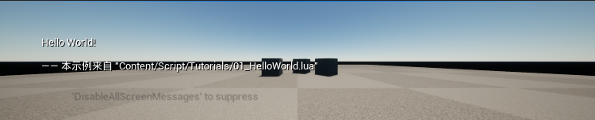
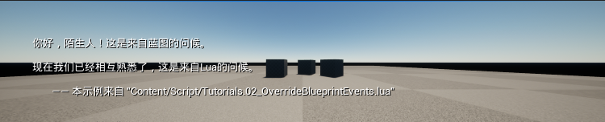
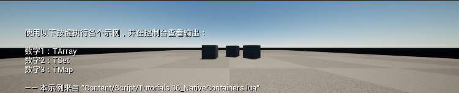
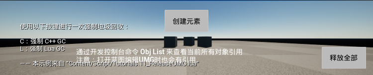

# Showcase 示例

这一页汇集 UnLuaNova 的**可运行示例**：每个示例都是一小段真实代码 + 一张跑出来的截图，
用来回答"这东西到底怎么用"，而不只是描述 API 签名。

示例的源码在 `Source/UnLuaNovaDemo/` 下，配套 Lua 脚本在工程的 `Content/Script/`
目录里；本页的截图由自动化测试产出，不是手截的。

## 示例清单

### 1. 绑定：UObject 与 Lua 双向调用

`UTutorialObject` 展示了最基础的一条链路——C++ 侧的类如何被 Lua 拿到、
Lua 侧的函数如何被 C++ 调回去。

要点：绑定入口与对象生命周期紧密相关。

### 2. 覆写：用 Lua 替换蓝图事件

`UTutorialBlueprintFunctionLibrary` 里的 `CallLuaByGlobalTable` 演示了从蓝图
侧进入 Lua、再由 Lua 覆写 `ReceiveBeginPlay` 这类事件的完整路径。

要点：覆写是**替换**而非追加，被覆写的实现默认不再执行；需要调用原实现时用
`Overridden` 系列的显式调用。

### 3. 容器：TArray / TMap / TSet 的 Lua 侧访问

`LuaLib_Array` / `LuaLib_Map` / `LuaLib_Set` 三个模块给出容器在 Lua 里的读写方式，
以及它们在 Lua 侧是引用语义（不拷贝容器本身）。`TSet` 现在也能 `pairs` 迭代。

### 4. UMG：Lua 接管界面与生命周期

`11_ReleaseUMG` 演示 UMG 控件交给 Lua 之后，父子控件的创建、释放与引用关系如何收敛——
这也是最容易写出悬挂引用的一类场景。

调试相关能力集中在[调试](Debugging.md)一页；内存统计走 `lua.memstats`
控制台命令，可以按内存类别看到 Lua 侧的分配分布。

## 延伸阅读

- [测试与自动化](Testing.md) — 示例截图由自动化测试产出
- [编程指南](UnLuaNova_Programming_Guide.md) — 编程指南
