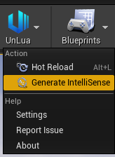
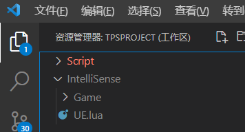
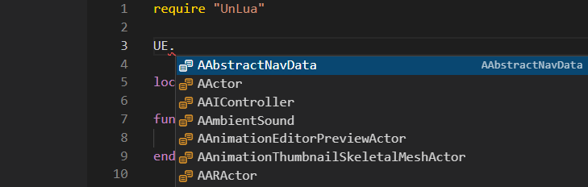

# IntelliSense

## 1. Generate the hint files



Open the UnLuaNova toolbar and click **Export IntelliSense**. It writes an `IntelliSense`
directory under `{UEProject}/Plugins/UnLuaNova/Intermediate`.

## 2. Add them to your Lua IDE



With VSCode, follow the demo project's
[UnLuaNovaDemo.code-workspace](https://github.com/HUSTJJD/UnLuaNova/blob/master/UnLuaNovaDemo.code-workspace):
the workspace lists both `Script` and `IntelliSense`, so regenerating refreshes completion
without any copying.

## 3. Check it works



Type `UE.` in any Lua file of the project - the engine types should come up. If nothing
appears, check that your IDE's Lua language extension is installed and enabled.

## 4. Luau declarations (for luau-analyze)

The same export also produces `UnLuaNova.d.lua`:

```
Plugins/UnLuaNova/Intermediate/IntelliSense/
├── *.lua                EmmyLua annotations, for IDE completion and for LuaLS on the Lua backend
└── UnLuaNova.d.lua      Luau declarations, for static checking with luau-analyze on the Luau backend
```

The first is type annotation for an IDE, the second is `declare class` / `declare function`
declarations for a static checker - **do not `require` it**, it is only referenced at check
time. Put the `.d.lua` next to your scripts and start the file with `--!strict`, and
`luau-analyze` will surface UE API misuse before you run anything.

See [Luau backend](Luau.md).

---

## Further reading

- [Debugging](Debugging.md) - debugging Lua scripts
- [Luau backend](Luau.md) - declarations and luau-analyze
- [FAQ](FAQ.md) - IntelliSense questions
- [Settings](Settings.md) - the "Generate IntelliSense" setting
