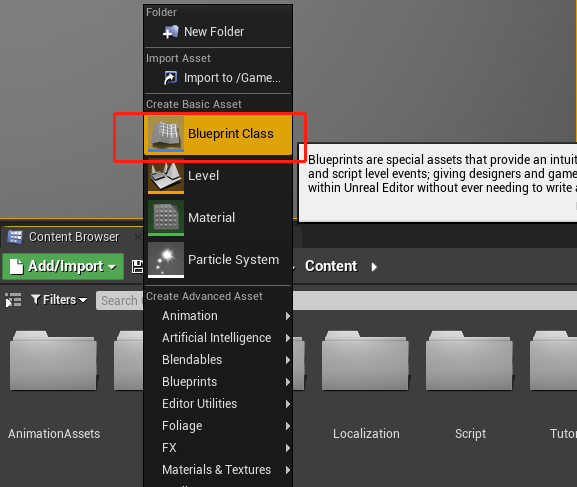
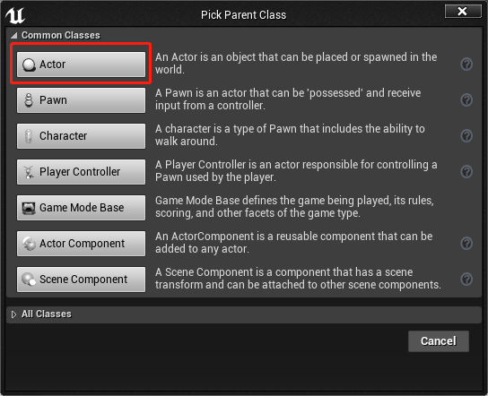
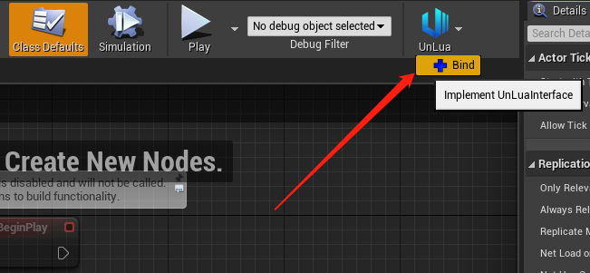
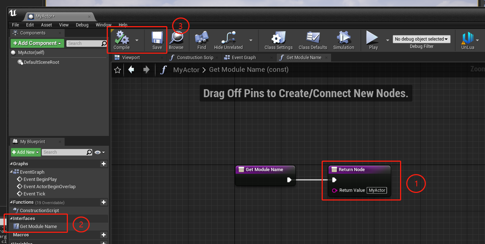
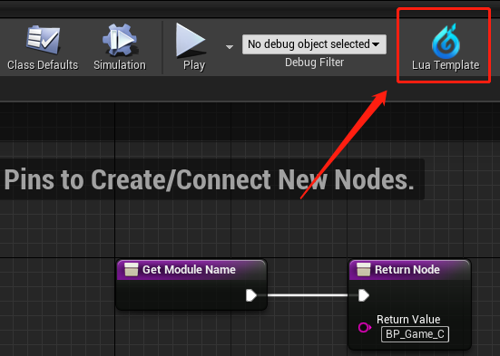
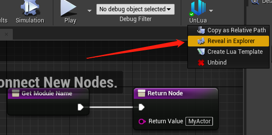

# Quickstart

Written for someone new to Unreal: an Actor subclass is used as the example, and everything
else works the same way.

If you already know Unreal, go straight to
[start using UnLuaNova](https://github.com/HUSTJJD/UnLuaNova#quick-start).

## 1. Create a Blueprint

## 2. Bind it to Lua

* Open the Blueprint you just created and pick **Bind** in the UnLuaNova menu; the Lua module
  path is filled in from the asset path (① in the screenshot).
* To change it later, find the `GetModuleName` function and edit it (②).
* **Compile** and **save** when you are done (③).

## 3. Generate the Lua template

Pick **Create Lua Template** in the UnLuaNova menu; the file lands under the project's
`Content/Script`.

## 4. You are ready

Open the generated file in your editor and start writing.

**Note:** the Content Browser does not show `.lua` files - use a system file explorer, or add
`Content/Script` to your IDE workspace so you never have to browse for it.

---

## Further reading

- [Features](Features.md) - what UnLuaNova can do
- [Programming Guide](UnLuaNova_Programming_Guide.md) - writing real logic
- [Custom Lua Templates](CustomTemplate.md) - customising the generated template
