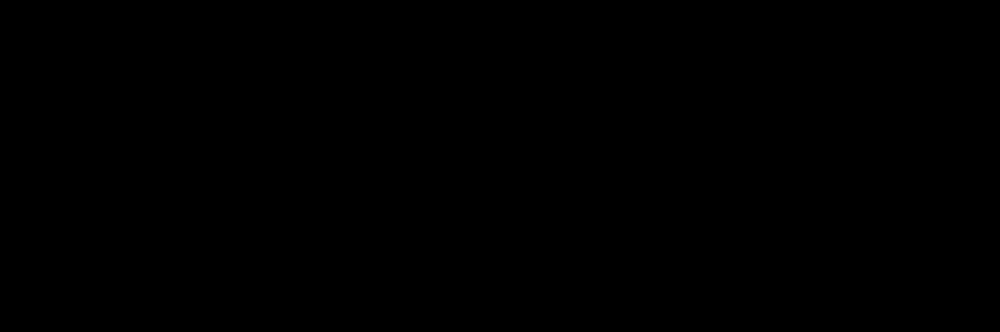
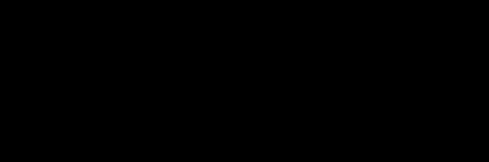
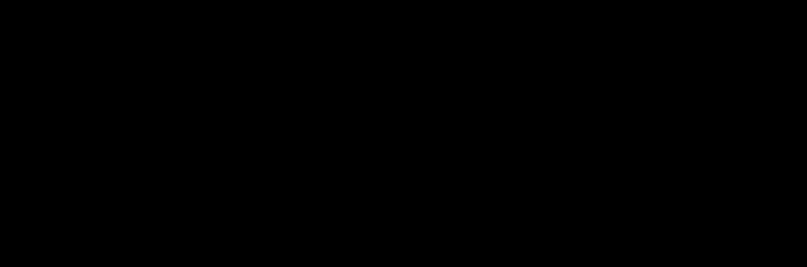
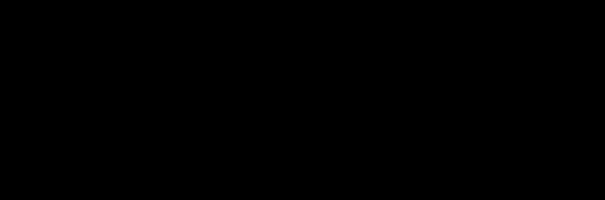

# 测试报告（Luau 后端）

> 由 `Tools/GenerateTestReport.py` 自动生成于 2026-10-22 15:56:25。请勿手工编辑。

## 结论

**存在失败 ❌（1 项）** — 通过率 99.5%

| 指标 | 数值 |
|---|---|
| 用例总数 | 436 |
| 通过 | 434 |
| 失败 | 1 |
| 跳过 | 1 |
| 总耗时 | 91.74s |
| 截图 | 4 |
| Lua 后端 | `Luau` |

## 通过明细（434 项）

| 用例 | 来源 | 耗时 |
|---|---|---|
| `* 全部已注册` | `index.json` | 0.052s |
| `64 位整数读写不截断` | `index.json` | 0.084s |
| `Binding 静态绑定示例截图` | `index.json` | 7.234s |
| `Container 容器访问示例截图` | `index.json` | 6.832s |
| `Dynamic 动态绑定，SpawnActor时指定脚本路径` | `index.json` | 0.100s |
| `F1` | `index.json` | 0.076s |
| `Full 返回全部Out参数` | `index.json` | 0.042s |
| `GC 设置可用，且两参数的 lua_gc 能取到数值` | `index.json` | 0.132s |
| `Get` | `index.json` | 0.062s |
| `Get` | `index.json` | 0.064s |
| `HasBuffer 与 HasFeature('buffer') 一致` | `index.json` | 0.067s |
| `HasFeature 与编译期能力一致` | `index.json` | 0.064s |
| `HasVector 与 HasFeature('vector') 一致` | `index.json` | 0.085s |
| `HotReload 能加载模块，而不是静默降级` | `index.json` | 0.073s |
| `Issue276 游戏世界暂停后，coroutine delay 功能不工作` | `index.json` | 1.868s |
| `Issue279 lua覆写蓝图的同名函数之后，无法将特定类型的函数参数保存到lua对象中` | `index.json` | 0.052s |
| `Issue284 require不存在的lib会崩` | `index.json` | 0.057s |
| `Issue286 蓝图 TMap FindRef 错误` | `index.json` | 0.719s |
| `Issue288 UMG里Image用到的Texture内存泄漏` | `index.json` | 0.183s |
| `Issue289 UClass在被UEGC后没有释放相应的绑定` | `index.json` | 0.178s |
| `Issue291 delegate绑定本身不在lua里有引用的object，在绑定后触发gc会导致无法调用绑定的函数` | `index.json` | 0.063s |
| `Issue292 actor调用K2_DestroyActor后，立刻调用IsValid会返回true` | `index.json` | 0.051s |
| `Issue293 关闭RPC会导致部分函数在非Editor模式下crash` | `index.json` | 0.050s |
| `Issue294 AutoCreateRefTerm标记的参数需要生成默认值` | `index.json` | 0.048s |
| `Issue295 动态绑定的UMG对象，在切换地图回调Destruct导致崩溃` | `index.json` | 1.428s |
| `Issue300 LUA覆写的函数返回给蓝图的值错误` | `index.json` | 1.104s |
| `Issue303 部分情况下为TArray创建拷贝至lua时会产生崩溃` | `index.json` | 0.046s |
| `Issue304 Lua中监听delegate，接收TArray参数，使用Get获取其中元素导致崩溃` | `index.json` | 0.051s |
| `Issue314 访问过父类不存在的字段，后续在子类中也只能取到nil` | `index.json` | 0.085s |
| `Issue321 同名蓝图加载冲突` | `index.json` | 0.082s |
| `Issue322 绑定中文名字的蓝图会报错` | `index.json` | 0.072s |
| `Issue323 一些默认参数的写法没有分析出来` | `index.json` | 0.051s |
| `Issue328 C++调用LUA覆写带返回值的函数会崩溃` | `index.json` | 0.063s |
| `Issue331 UENUM的某一项为表达式时，默认值没有分析出来` | `index.json` | 0.048s |
| `Issue344 在Lua中对UClass_Load出来的对象写入属性后，GC的时候会Crash` | `index.json` | 0.057s |
| `Issue346 BlueprintFunctionLibrary无法静态绑定到lua文件` | `index.json` | 0.257s |
| `Issue362 TArray引用做委托参数在lua中修改不生效` | `index.json` | 0.063s |
| `Issue366 使用ADD_SHARED_PTR_CONSTRUCTOR后启动直接崩溃` | `index.json` | 0.055s |
| `Issue367 类型元表被LuaGC时，可能意外导致正在使用的FClassDesc被错误delete` | `index.json` | 0.136s |
| `Issue372 Actor调用K2_DestroyActor销毁时，lua部分会在注册表残留` | `index.json` | 0.892s |
| `Issue375 子类被销毁时，可能会令父类的Lua绑定失效` | `index.json` | 0.109s |
| `Issue376 引用参数传递失败` | `index.json` | 0.049s |
| `Issue398 接口列表从lua传到c++/蓝图层会丢失一半信息` | `index.json` | 0.063s |
| `Issue400 不同实例的多播委托绑定相同实例函数，清理时崩溃` | `index.json` | 0.134s |
| `Issue401 LUA覆写导致数组传参错误` | `index.json` | 0.789s |
| `Issue407 无法在lua中将一个TMap调用Keys的结果传给C++` | `index.json` | 0.031s |
| `Issue430 动画通知调用组件Lua覆写函数崩溃` | `index.json` | 2.034s |
| `Issue432 Lua调用的函数返回蓝图结构体会check` | `index.json` | 0.053s |
| `Issue434 MulticastDelegate创建Handler时和self绑定` | `index.json` | 1.319s |
| `Issue443 在某些代码块内无法调用蓝图函数` | `index.json` | 1.796s |
| `Issue445 TSubclassOf作为函数返回值，从lua传回C++为空` | `index.json` | 0.067s |
| `Issue446 实现了FTickableGameObject的对象在Tick里调用自身被Lua覆写的方法会崩溃` | `index.json` | 1.400s |
| `Issue453 从Lua按引用传递到蓝图的TArray引用变成了空Array` | `index.json` | 0.901s |
| `Issue455 CacheScriptContainer导致的崩溃` | `index.json` | 3.165s |
| `Issue471 FScriptDelegate解绑无效` | `index.json` | 1.662s |
| `Issue473 FName类型参数中文乱码` | `index.json` | 0.034s |
| `Issue476 通过NewObject接口添加的UObject引用无法释放` | `index.json` | 0.109s |
| `Issue477 遍历蓝图结构体的DataTable会发生拷贝错误` | `index.json` | 0.299s |
| `Issue517 Actor的Struct成员变量在Lua里引用，释放后仍旧可以访问` | `index.json` | 0.112s |
| `Issue539 Lua覆写Out返回值时无法返回nil` | `index.json` | 0.052s |
| `Issue554 访问非TArray的结构体数组报错` | `index.json` | 0.053s |
| `Issue556 Lua覆写的函数接收数组参数时可能无效` | `index.json` | 0.056s |
| `Issue561 访问UStruct内部的委托会check` | `index.json` | 0.057s |
| `Issue562 容器元素为蓝图类型时，在蓝图Class被提前UE回收后，会导致容器在luagc时报错` | `index.json` | 0.167s |
| `Issue566 多次传递委托类型的参数到同一函数时，可能因为Owner失效而无法回调` | `index.json` | 0.132s |
| `Issue583 在Lua中遍历TMap字段的Values接口返回值时引起的崩溃` | `index.json` | 0.072s |
| `Issue585 蓝图枚举无法被UnLuaRef` | `index.json` | 0.282s |
| `Issue595 Lua无法调用Interface中函数` | `index.json` | 0.096s |
| `Issue603 在Lua监听的事件中再次触发事件会导致崩溃` | `index.json` | 1.876s |
| `Issue634 覆写非ReturnValue的C++结构体返回值会导致崩溃` | `index.json` | 1.750s |
| `Issue660 Unlua函数绑定多个代理导致崩溃` | `index.json` | 1.853s |
| `Issue668 在Lua中调用TArray的Add接口时内存对齐引起的问题` | `index.json` | 0.039s |
| `IssueOverrides 覆写引起的问题` | `index.json` | 1.268s |
| `Key不存在，新增` | `index.json` | 0.081s |
| `Key不存在，返回false` | `index.json` | 0.065s |
| `Key存在，移除并返回true` | `index.json` | 0.062s |
| `Key存在，覆盖` | `index.json` | 0.064s |
| `Lua 侧的 64 位字面量能完整取回` | `index.json` | 0.136s |
| `Luau 语法能编译并按预期求值` | `index.json` | 0.061s |
| `Multiple 多重绑定：同一个Lua脚本绑定到不同类` | `index.json` | 0.102s |
| `Num` | `index.json` | 0.081s |
| `Overridden 覆写：同一个Lua脚本绑定到不同类` | `index.json` | 0.104s |
| `Override 蓝图事件覆写示例截图` | `index.json` | 6.723s |
| `PUSHINT 推入的值能在脚本里参与算术` | `index.json` | 0.094s |
| `PUSHINT64 推入的值被认作整数且能完整读回` | `index.json` | 0.106s |
| `Partial 返回部分Out参数，剩余部分使用传入参数填充` | `index.json` | 0.045s |
| `Priority 绑定冲突：静态绑定优先于动态绑定` | `index.json` | 0.092s |
| `Reset 清零` | `index.json` | 0.074s |
| `Set` | `index.json` | 0.066s |
| `Set` | `index.json` | 0.057s |
| `Static 静态绑定，继承UnLuaInterface::GetModuleName指定脚本路径` | `index.json` | 0.088s |
| `UMG UMG 与 Lua 生命周期示例截图` | `index.json` | 6.725s |
| `UNLUANOVA_IS_YIELDABLE 区分主线程与协程` | `index.json` | 0.074s |
| `UNLUANOVA_LOAD 能加载并执行 chunk` | `index.json` | 0.097s |
| `UNLUANOVA_RESUME 能恢复协程并带回结果` | `index.json` | 0.077s |
| `UnLuaNovaIsIntegralNumber 区分整数与非整数` | `index.json` | 0.085s |
| `VM hook 能安装、收到事件并按 owner 撤回` | `index.json` | 0.084s |
| `Vector 能把原生 vector 转成 FVector` | `index.json` | 0.065s |
| `attach / detach` | `index.json` | 0.081s |
| `buffer 能按类型读写` | `index.json` | 0.073s |
| `collect 返回 0，与 plain Lua 一致` | `index.json` | 0.111s |
| `core 也能单独 require 到` | `index.json` | 0.095s |
| `count 返回 KBytes 数字` | `index.json` | 0.107s |
| `debug 提供 upvalue / local / registry 访问` | `index.json` | 0.097s |
| `decode 能解析出字段` | `index.json` | 0.141s |
| `encode/decode 往返一致` | `index.json` | 0.073s |
| `gc 之后 Lua 值仍然可用` | `index.json` | 0.085s |
| `gettime 返回递增的数字，不依赖网络` | `index.json` | 0.085s |
| `getupvalue 能读到闭包捕获的值` | `index.json` | 0.069s |
| `luaL_newmetatable 建的元表带 __name` | `index.json` | 0.074s |
| `luaL_newmetatable 第二次调用返回 0` | `index.json` | 0.075s |
| `luaL_ref / luaL_unref 往返一致` | `index.json` | 0.081s |
| `package 同时提供 loaded 和 searchers` | `index.json` | 0.076s |
| `protoc 加载内联 proto 后编解码一致` | `index.json` | 0.086s |
| `require 也能拿到模块表` | `index.json` | 0.059s |
| `require 入口在两个后端下都安全返回` | `index.json` | 0.095s |
| `require 拿到 socket 模块` | `index.json` | 0.087s |
| `require 拿到可用的 pb 模块` | `index.json` | 0.074s |
| `require 拿到带 decode/encode 的模块表` | `index.json` | 0.098s |
| `setupvalue 能给 chunk 设环境` | `index.json` | 0.082s |
| `trim 是 strip 的别名` | `index.json` | 0.071s |
| `不匹配时为假` | `index.json` | 0.056s |
| `不增加重复的元素` | `index.json` | 0.085s |
| `不存在的枚举值返回nil` | `index.json` | 0.083s |
| `不存在的枚举值返回nil` | `index.json` | 0.082s |
| `不相等` | `index.json` | 0.095s |
| `两个后端都存在` | `index.json` | 0.086s |
| `两个后端都能从字符串加载 chunk` | `index.json` | 0.085s |
| `两个环境互不影响` | `index.json` | 0.117s |
| `两点相乘` | `index.json` | 0.049s |
| `两点相减` | `index.json` | 0.042s |
| `两点相加` | `index.json` | 0.087s |
| `两点相除` | `index.json` | 0.046s |
| `交换两个索引位置的元素` | `index.json` | 0.071s |
| `使用[]获取` | `index.json` | 0.060s |
| `使用[]赋值` | `index.json` | 0.066s |
| `元素不存在，新增` | `index.json` | 0.076s |
| `元素不存在，返回false` | `index.json` | 0.094s |
| `元素存在，移除并返回true` | `index.json` | 0.081s |
| `关闭后不再记账` | `index.json` | 0.083s |
| `函数解析到真实的 UFunction 并填好 flag` | `index.json` | 0.047s |
| `分别指定Pitch/Yaw/Roll` | `index.json` | 0.097s |
| `分别指定X/Y` | `index.json` | 0.063s |
| `分别指定X/Y/Z` | `index.json` | 0.041s |
| `分别指定X/Y/Z` | `index.json` | 0.070s |
| `分别指定X/Y/Z/W` | `index.json` | 0.201s |
| `分别指定X和Y` | `index.json` | 0.046s |
| `分发条件：非网络 / 非 latent / 非接口函数会走预解析路径` | `index.json` | 0.079s |
| `分配回调能收到分配事件` | `index.json` | 0.059s |
| `分隔符按字面量处理，不是模式` | `index.json` | 0.089s |
| `创建Actor，仅指定Actor类型` | `index.json` | 0.077s |
| `创建Actor，指定初始Transform` | `index.json` | 0.080s |
| `创建Actor，指定初始Transform/CollisionHanding/Owner` | `index.json` | 0.093s |
| `创建Actor，指定初始Transform/CollisionHanding/Owner/Instigator` | `index.json` | 0.090s |
| `创建Actor，指定初始Transform/CollisionHandling` | `index.json` | 0.089s |
| `删除元素后迭代不会带回空洞` | `index.json` | 0.082s |
| `判断对象是否为指定类型` | `index.json` | 0.088s |
| `前缀` | `index.json` | 0.063s |
| `加载一个对象` | `index.json` | 0.091s |
| `单步能停下来并抓到调用栈` | `index.json` | 0.080s |
| `原生 vector 能进出 FVector` | `index.json` | 0.064s |
| `原生后端下可以往返 FVector` | `index.json` | 0.076s |
| `原生：调用的函数本身有返回值，先返回返回值再依次返回参数` | `index.json` | 0.088s |
| `原生：调用的函数本身没有返回值，依次返回参数` | `index.json` | 0.101s |
| `去掉首尾空白` | `index.json` | 0.065s |
| `取反向量` | `index.json` | 0.041s |
| `取反向量` | `index.json` | 0.068s |
| `取反向量` | `index.json` | 0.065s |
| `取反向量` | `index.json` | 0.061s |
| `取消注册后查不到` | `index.json` | 0.064s |
| `取相反数` | `index.json` | 0.042s |
| `只能够对空数组进行预留空间操作` | `index.json` | 0.064s |
| `只读表能置位也能读回` | `index.json` | 0.098s |
| `只追加不重复的元素` | `index.json` | 0.079s |
| `可以 require 到模块表` | `index.json` | 0.071s |
| `可以 require 到模块表` | `index.json` | 0.091s |
| `合法位置索引返回true` | `index.json` | 0.060s |
| `同时指定Pitch/Yaw/Roll` | `index.json` | 0.097s |
| `同时指定X/Y` | `index.json` | 0.060s |
| `同时指定X/Y/Z` | `index.json` | 0.044s |
| `同时指定X/Y/Z` | `index.json` | 0.069s |
| `同时指定X和Y` | `index.json` | 0.040s |
| `后缀` | `index.json` | 0.064s |
| `向量乘` | `index.json` | 0.078s |
| `向量乘以数字` | `index.json` | 0.061s |
| `向量乘以整数` | `index.json` | 0.040s |
| `向量乘以浮点数` | `index.json` | 0.069s |
| `向量相减` | `index.json` | 0.043s |
| `向量相减` | `index.json` | 0.068s |
| `向量相减` | `index.json` | 0.067s |
| `向量相减` | `index.json` | 0.067s |
| `向量相加` | `index.json` | 0.046s |
| `向量相加` | `index.json` | 0.088s |
| `向量相加` | `index.json` | 0.068s |
| `向量相加` | `index.json` | 0.060s |
| `向量除` | `index.json` | 0.060s |
| `向量除以数字` | `index.json` | 0.053s |
| `向量除以整数` | `index.json` | 0.044s |
| `向量除以浮点数` | `index.json` | 0.070s |
| `启动时已填充，且至少有一个函数带默认值` | `index.json` | 0.086s |
| `四元数乘以浮点数` | `index.json` | 0.090s |
| `大于等于容差，归一化` | `index.json` | 0.091s |
| `大于等于容差，归一化` | `index.json` | 0.071s |
| `大于等于容差，归一化并返回true` | `index.json` | 0.074s |
| `将Map内容转为LuaTable` | `index.json` | 0.069s |
| `将Set内容转为LuaTable` | `index.json` | 0.087s |
| `将当前Transform与目标Transform混合` | `index.json` | 0.092s |
| `将当前Transform与目标两个Transform混合` | `index.json` | 0.094s |
| `将数组内容转为LuaTable` | `index.json` | 0.080s |
| `小于容差，不归一化` | `index.json` | 0.167s |
| `小于容差，不归一化` | `index.json` | 0.069s |
| `小于容差，直接返回false` | `index.json` | 0.070s |
| `属性解析到真实的 FProperty` | `index.json` | 0.046s |
| `常见 UProperty 映射到对应的 Kind` | `index.json` | 0.063s |
| `广播事件` | `index.json` | 0.081s |
| `开关可切换， detach 之后关闭` | `index.json` | 0.085s |
| `开启后统计分配次数与字节数` | `index.json` | 0.077s |
| `开启后脚本仍能正常执行` | `index.json` | 0.075s |
| `执行失败返回false` | `index.json` | 0.090s |
| `执行委托` | `index.json` | 0.070s |
| `执行委托：从Lua返回值` | `index.json` | 0.070s |
| `执行委托：赋值` | `index.json` | 0.073s |
| `执行成功返回true` | `index.json` | 0.106s |
| `扩容，使用默认元素填充` | `index.json` | 0.073s |
| `找到元素，返回索引位置` | `index.json` | 0.063s |
| `拷贝指定索引位置的元素` | `index.json` | 0.065s |
| `指定ColorValue` | `index.json` | 0.087s |
| `指定RGB` | `index.json` | 0.088s |
| `指定RGB` | `index.json` | 0.095s |
| `指定RGBA` | `index.json` | 0.088s |
| `指定RGBA` | `index.json` | 0.093s |
| `指定Rotation(FQuat)` | `index.json` | 0.068s |
| `指定Rotation(FQuat)/Translation` | `index.json` | 0.073s |
| `指定Rotation(FQuat)/Translation/Scale` | `index.json` | 0.073s |
| `指定X` | `index.json` | 0.074s |
| `指定X/Y` | `index.json` | 0.082s |
| `指定X/Y/Z` | `index.json` | 0.065s |
| `指定X/Y/Z/W` | `index.json` | 0.057s |
| `指定轴与角度` | `index.json` | 0.175s |
| `按引用获取元素（原生）` | `index.json` | 0.076s |
| `按引用获取元素（原生）` | `index.json` | 0.061s |
| `按引用获取元素（蓝图）` | `index.json` | 0.086s |
| `按引用获取元素（蓝图）` | `index.json` | 0.062s |
| `插入元素到指定位置` | `index.json` | 0.056s |
| `支持启动脚本和参数` | `index.json` | 0.098s |
| `支持多个Lua环境` | `index.json` | 0.118s |
| `支持多参数传入和传出` | `index.json` | 0.102s |
| `数组不包含指定元素返回false` | `index.json` | 0.073s |
| `数组包含指定元素返回true` | `index.json` | 0.060s |
| `断点原语可用` | `index.json` | 0.109s |
| `断点登记` | `index.json` | 0.069s |
| `显式传参会覆盖默认值` | `index.json` | 0.095s |
| `有 buffer 的后端下 TArray 往返保持内容` | `index.json` | 0.078s |
| `有静态绑定时出参与返回值都正确` | `index.json` | 0.084s |
| `有静态绑定时，Lua 调用结果正确` | `index.json` | 0.095s |
| `构造TArray<FString>` | `index.json` | 0.059s |
| `构造TArray<FVector>` | `index.json` | 0.058s |
| `构造TArray<UStruct>` | `index.json` | 0.061s |
| `构造TArray<bool>` | `index.json` | 0.075s |
| `构造TArray<int32>` | `index.json` | 0.062s |
| `构造TMap<FString,FString>` | `index.json` | 0.064s |
| `构造TMap<FVector,bool>` | `index.json` | 0.063s |
| `构造TMap<UStruct,UStruct>` | `index.json` | 0.072s |
| `构造TMap<int32,int32>` | `index.json` | 0.063s |
| `构造TSet<FString>` | `index.json` | 0.080s |
| `构造TSet<FVector>` | `index.json` | 0.092s |
| `构造TSet<UScriptStruct>` | `index.json` | 0.083s |
| `构造TSet<int32>` | `index.json` | 0.115s |
| `枚举默认值也生效` | `index.json` | 0.104s |
| `查找Key不存在，返回nil` | `index.json` | 0.057s |
| `查找Key不存在，返回nil` | `index.json` | 0.064s |
| `查找Key存在，返回Value的引用` | `index.json` | 0.053s |
| `查找Key存在，返回Value的拷贝` | `index.json` | 0.062s |
| `查找元素不存在，返回false` | `index.json` | 0.081s |
| `查找元素存在，返回true` | `index.json` | 0.080s |
| `栈帧能取到源码行，Profiler 键稳定且唯一` | `index.json` | 0.073s |
| `正确传入FName到Lua堆栈` | `index.json` | 0.071s |
| `正确传入FString到Lua堆栈` | `index.json` | 0.076s |
| `正确传入UObject到Lua堆栈` | `index.json` | 0.082s |
| `正确传入bool到Lua堆栈` | `index.json` | 0.084s |
| `正确传入const char*到Lua堆栈` | `index.json` | 0.079s |
| `正确传入double到Lua堆栈` | `index.json` | 0.102s |
| `正确传入float到Lua堆栈` | `index.json` | 0.075s |
| `正确传入int16到Lua堆栈` | `index.json` | 0.076s |
| `正确传入int32到Lua堆栈` | `index.json` | 0.066s |
| `正确传入int64到Lua堆栈` | `index.json` | 0.099s |
| `正确传入int8到Lua堆栈` | `index.json` | 0.080s |
| `正确传入struct到Lua堆栈` | `index.json` | 0.080s |
| `正确传入uint16到Lua堆栈` | `index.json` | 0.077s |
| `正确传入uint32到Lua堆栈` | `index.json` | 0.080s |
| `正确传入uint64到Lua堆栈` | `index.json` | 0.080s |
| `正确传入uint8到Lua堆栈` | `index.json` | 0.080s |
| `正确传入void*到Lua堆栈` | `index.json` | 0.093s |
| `正确传入中文FString到Lua堆栈` | `index.json` | 0.088s |
| `正确判断子类` | `index.json` | 0.108s |
| `正确加载蓝图类` | `index.json` | 0.076s |
| `正确获取类默认对象` | `index.json` | 0.083s |
| `沙盒下 UE 命名空间仍能写入：类型注册不会被冻住` | `index.json` | 0.072s |
| `沙盒开启后全局表只读` | `index.json` | 0.066s |
| `没有分隔符时返回整串` | `index.json` | 0.076s |
| `没有找到元素，返回0` | `index.json` | 0.062s |
| `没有静态绑定时，同一个调用的结果一致` | `index.json` | 0.108s |
| `注册后能按 USTRUCT 和名字查到同一个表` | `index.json` | 0.055s |
| `添加绑定` | `index.json` | 0.094s |
| `添加绑定：UFunction` | `index.json` | 0.086s |
| `添加绑定：赋值` | `index.json` | 0.089s |
| `清理所有的绑定` | `index.json` | 0.081s |
| `清除数组，移除所有元素` | `index.json` | 0.062s |
| `清除，移除所有元素` | `index.json` | 0.077s |
| `清除，移除所有键值对` | `index.json` | 0.057s |
| `环境启动后即可直接用` | `index.json` | 0.077s |
| `生成静态绑定表到 -OutputDir 指定的目录` | `index.json` | 2.668s |
| `用分隔符拼接并转字符串` | `index.json` | 0.059s |
| `相等` | `index.json` | 0.087s |
| `省略的 C++ 默认参数照样生效` | `index.json` | 0.123s |
| `移除指定元素` | `index.json` | 0.064s |
| `移除指定索引处的元素` | `index.json` | 0.069s |
| `移除绑定` | `index.json` | 0.105s |
| `移除绑定：UFunction` | `index.json` | 0.092s |
| `空串恒为真` | `index.json` | 0.071s |
| `空的子串返回 0 而不是死循环` | `index.json` | 0.058s |
| `空表得到空串` | `index.json` | 0.075s |
| `绑定` | `index.json` | 0.067s |
| `绑定：UFunction` | `index.json` | 0.096s |
| `绑定：赋值` | `index.json` | 0.097s |
| `统计不重叠出现次数` | `index.json` | 0.063s |
| `编译期能力位与后端一致` | `index.json` | 0.086s |
| `编辑器模块可加载且命令上下文已注册` | `index.json` | 0.075s |
| `缩容，移除多余元素` | `index.json` | 0.068s |
| `脚本依赖的标准库在两个后端都在` | `index.json` | 0.075s |
| `脚本改写 UE 命名空间被拦截` | `index.json` | 0.073s |
| `脚本根目录指向工程的 Content/Script` | `index.json` | 0.059s |
| `脚本能问到当前后端` | `index.json` | 0.077s |
| `获取Map长度` | `index.json` | 0.073s |
| `获取Set长度` | `index.json` | 0.086s |
| `获取对象所在的World` | `index.json` | 0.100s |
| `获取对象的名称` | `index.json` | 0.096s |
| `获取对象的外部对象` | `index.json` | 0.118s |
| `获取对象的有效状态` | `index.json` | 0.224s |
| `获取对象的类型` | `index.json` | 0.094s |
| `获取平方后的长度` | `index.json` | 0.041s |
| `获取所有Key的数组` | `index.json` | 0.064s |
| `获取所有Value的数组` | `index.json` | 0.077s |
| `获取所有元素的数组` | `index.json` | 0.079s |
| `获取指定索引位置的元素引用` | `index.json` | 0.059s |
| `获取数据表中指定行的数据（C++）` | `index.json` | 0.114s |
| `获取数据表中指定行的数据（蓝图）` | `index.json` | 0.122s |
| `获取数组分配的内存指针` | `index.json` | 0.060s |
| `获取数组最后一个元素的索引位置` | `index.json` | 0.074s |
| `获取数组长度` | `index.json` | 0.069s |
| `获取枚举的名称` | `index.json` | 0.096s |
| `获取枚举的本地化文本` | `index.json` | 0.083s |
| `获取枚举类型的最大值` | `index.json` | 0.085s |
| `蓝图：调用的函数本身有返回值，先返回返回值再依次返回参数` | `index.json` | 0.152s |
| `蓝图：调用的函数本身没有返回值，依次返回参数` | `index.json` | 0.110s |
| `表里写了不存在的成员时跳过而不是崩` | `index.json` | 0.051s |
| `解绑` | `index.json` | 0.070s |
| `设置Pitch` | `index.json` | 0.113s |
| `设置Pitch/Yaw` | `index.json` | 0.107s |
| `设置Pitch/Yaw/Roll` | `index.json` | 0.103s |
| `设置R` | `index.json` | 0.083s |
| `设置R` | `index.json` | 0.091s |
| `设置RG` | `index.json` | 0.080s |
| `设置RG` | `index.json` | 0.089s |
| `设置RGB` | `index.json` | 0.082s |
| `设置RGB` | `index.json` | 0.099s |
| `设置RGBA` | `index.json` | 0.080s |
| `设置RGBA` | `index.json` | 0.091s |
| `设置X` | `index.json` | 0.046s |
| `设置X` | `index.json` | 0.042s |
| `设置X` | `index.json` | 0.175s |
| `设置X` | `index.json` | 0.074s |
| `设置X` | `index.json` | 0.066s |
| `设置X` | `index.json` | 0.057s |
| `设置X/Y` | `index.json` | 0.038s |
| `设置X/Y` | `index.json` | 0.382s |
| `设置X/Y` | `index.json` | 0.069s |
| `设置X/Y` | `index.json` | 0.066s |
| `设置X/Y` | `index.json` | 0.065s |
| `设置X/Y/Z` | `index.json` | 0.774s |
| `设置X/Y/Z` | `index.json` | 0.068s |
| `设置X/Y/Z` | `index.json` | 0.059s |
| `设置X/Y/Z/W` | `index.json` | 0.289s |
| `设置X/Y/Z/W` | `index.json` | 0.078s |
| `设置XY` | `index.json` | 0.043s |
| `设置指定索引位置的元素` | `index.json` | 0.057s |
| `设置防止无限循环的超时时间` | `index.json` | 1.089s |
| `访问反射枚举` | `index.json` | 0.065s |
| `访问反射类` | `index.json` | 0.064s |
| `访问导出类` | `index.json` | 0.063s |
| `调用失败，返回值被标记为无效` | `index.json` | 0.095s |
| `调用失败，返回值被标记为无效` | `index.json` | 0.115s |
| `调用成功，返回正确的返回值` | `index.json` | 0.081s |
| `调用成功，返回正确的返回值` | `index.json` | 0.100s |
| `调试通道原语可用` | `index.json` | 0.078s |
| `转为字符串` | `index.json` | 0.083s |
| `转为字符串` | `index.json` | 0.041s |
| `转为字符串` | `index.json` | 0.038s |
| `转为字符串` | `index.json` | 0.094s |
| `转为字符串` | `index.json` | 0.319s |
| `转为字符串` | `index.json` | 0.103s |
| `转为字符串` | `index.json` | 0.075s |
| `转为字符串` | `index.json` | 0.074s |
| `转为字符串` | `index.json` | 0.063s |
| `转为字符串` | `index.json` | 0.058s |
| `运行时模块都在插件的 Content/Script 下` | `index.json` | 0.082s |
| `迭代元方法注册在后端认识的名字下` | `index.json` | 0.077s |
| `迭代拿到Set里的每个元素` | `index.json` | 0.086s |
| `迭代获取Key与Value` | `index.json` | 0.061s |
| `迭代获取数组索引与元素` | `index.json` | 0.088s |
| `追加元素到数组末尾` | `index.json` | 0.066s |
| `追加另外一个数组的所有元素到数组末尾` | `index.json` | 0.073s |
| `销毁环境会跑完所有 __gc，且不破坏内存` | `index.json` | 0.112s |
| `随插件发布且带 ClassName 占位符` | `index.json` | 0.065s |
| `随机打乱数组元素位置` | `index.json` | 0.067s |
| `非整数读回为 0，而不是被截断` | `index.json` | 0.091s |
| `非法位置索引返回false` | `index.json` | 0.065s |
| `预留N个数组元素的空间` | `index.json` | 0.066s |
| `颜色相乘` | `index.json` | 0.089s |
| `颜色相减` | `index.json` | 0.090s |
| `颜色相加` | `index.json` | 0.084s |
| `颜色相加` | `index.json` | 0.044s |
| `颜色相除` | `index.json` | 0.116s |
| `默认参数` | `index.json` | 0.081s |
| `默认参数` | `index.json` | 0.041s |
| `默认参数` | `index.json` | 0.048s |
| `默认参数` | `index.json` | 0.083s |
| `默认参数` | `index.json` | 0.118s |
| `默认参数` | `index.json` | 0.093s |
| `默认参数` | `index.json` | 0.087s |
| `默认参数` | `index.json` | 0.080s |
| `默认参数` | `index.json` | 0.060s |
| `默认参数` | `index.json` | 0.066s |
| `默认逗号分隔` | `index.json` | 0.103s |

## 跳过明细（1 项）

| 用例 | 来源 |
|---|---|
| `luau-analyze` | `luau-analyze.json` |

## 失败明细

### `未知选项报错而不是静默`

- 来源：`index.json`
- 耗时：0.340s
- 1 reported
- Expected 'lua_toboolean(L, -1)' to be 0, but it was 1.  [<UE>\Engine\Source\Runtime\Core\Public\Misc\AutomationTest.h:3119]

## 最慢的用例

| 用例 | 耗时 |
|---|---|
| `Binding 静态绑定示例截图` | 7.234s |
| `Container 容器访问示例截图` | 6.832s |
| `UMG UMG 与 Lua 生命周期示例截图` | 6.725s |
| `Override 蓝图事件覆写示例截图` | 6.723s |
| `Issue455 CacheScriptContainer导致的崩溃` | 3.165s |
| `生成静态绑定表到 -OutputDir 指定的目录` | 2.668s |
| `Issue430 动画通知调用组件Lua覆写函数崩溃` | 2.034s |
| `Issue603 在Lua监听的事件中再次触发事件会导致崩溃` | 1.876s |
| `Issue276 游戏世界暂停后，coroutine delay 功能不工作` | 1.868s |
| `Issue660 Unlua函数绑定多个代理导致崩溃` | 1.853s |

## 截图

### Showcase_Binding

### Showcase_Container

### Showcase_Override

### Showcase_UMG

## 视频

### Showcase_Binding_Clip

<video controls muted loop playsinline width="640" src="Images/tests-luau/Showcase_Binding_Clip.mp4"></video>

，60 帧，由这些帧编码而成（`Tools/RunTests.ps1 -Video`）。

### Showcase_Container_Clip

<video controls muted loop playsinline width="640" src="Images/tests-luau/Showcase_Container_Clip.mp4"></video>

，60 帧，由这些帧编码而成（`Tools/RunTests.ps1 -Video`）。

### Showcase_Override_Clip

<video controls muted loop playsinline width="640" src="Images/tests-luau/Showcase_Override_Clip.mp4"></video>

，60 帧，由这些帧编码而成（`Tools/RunTests.ps1 -Video`）。

### Showcase_UMG_Clip

<video controls muted loop playsinline width="640" src="Images/tests-luau/Showcase_UMG_Clip.mp4"></video>

，60 帧，由这些帧编码而成（`Tools/RunTests.ps1 -Video`）。

## 静态类型检查

这一轮没有跑：`Tools/RunTests.ps1` 没写 `luau-analyze.json`。

---

原始 JSON 留在本机 `Saved/TestReports/<时间戳>/<后端>/`（`Saved/` 不入库），这里只提交结论。重新生成：`Tools/RunTests.ps1 -Backend Luau -Publish`（要两份就 `-Backend Both`）。

