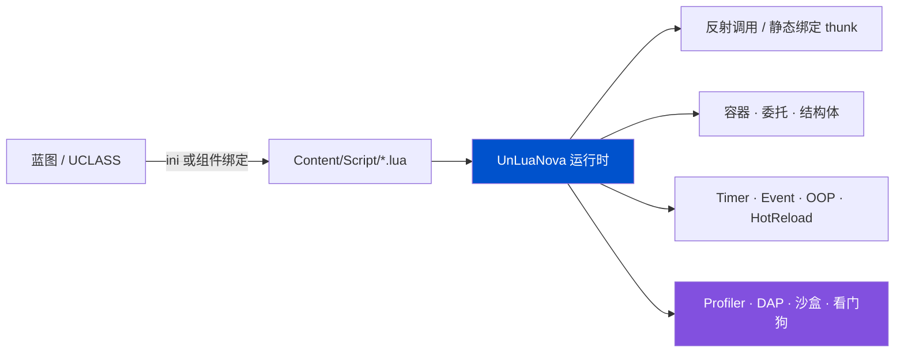

<div align="center">


# UnLuaNova

**Unreal Engine 的 Lua / Luau 脚本方案 —— 不 fork 引擎、能运营期热更、性能可测**

_UnLua 的发布线停在 v2.3.6（2023-11）。这里把散落的社区成果收敛成一条有人维护、可验证、可诊断的发行线。_

[](https://www.unrealengine.com/)
[](Plugins/UnLuaNova/Source/ThirdParty/VERSIONS.md)
[](Docs/CN/Testing.md)
[](LICENSE)
[](https://hustjjd.github.io/UnLuaNova/)
[](README_EN.md)

📖 **在线文档**：<https://hustjjd.github.io/UnLuaNova/>

</div>

---

## 🎬 30 秒看懂

```lua
-- Content/Script/MyActor.lua
local M = UnLuaNova.Class()

function M:ReceiveBeginPlay()
    print("backend:", UnLuaNova.GetBackend())
end

function M:ReceiveTick(DeltaSeconds)
    local Loc = self:K2_GetActorLocation()      -- UFUNCTION，直接调
    Loc.Z = Loc.Z + 100 * DeltaSeconds
    self:K2_SetActorLocation(Loc, false, nil, true)
end

return M
```

绑定不写胶水代码：**类 → Lua 模块的映射写在 ini 里**（或蓝图上加个绑定组件），
UE 侧一行代码都不用改 —— 不再是"必须实现 `IUnLuaNovaInterface`"。



---

## 💎 为什么选 UnLuaNova

九条，每条都写清**机制**，不写形容词。

| # | 优势 | 机制 |
|---|---|---|
| 1 | **覆盖面广，而且每一条都能被核对** | **40 项能力 / 15 个域**逐项登记实现范围。更关键的是"跑过了"这件事有独立证据：`Tools/evidence/` 存真实自动化报告归集出的执行结果，而能力矩阵里的状态字段**禁止手改**（改了仓库检查就失败）。宣称覆盖面很容易，可核对很难 |
| 2 | **不 fork 引擎，不用改引擎一行代码** | 纯插件，编译进你的工程。对比需要源码引擎分支的方案（UE-AngelScript）和需要替换 il2cpp 运行时的方案（huatuo/HybridCLR）：**升级引擎版本不用等我们适配** |
| 3 | **双后端，Luau 实测更快** | Lua 5.5.1 与 Luau 共用一套后端抽象，编译期切换。同机同构建下，**Luau 在容器负载上比 Lua 5.5.1 快 2.08×**（见下方实测表） |
| 4 | **运营期真热更** | 脚本是数据，可以不重启客户端下发。静态类型的脚本方案做不到 —— 这是 Lua 方案相对 AngelScript / Verse 的**独占优势** |
| 5 | **静态绑定绕开反射热路径** | 构建期为导出类型生成绑定表，运行时不再做反射查找与参数编组。默认**全导出**（opt-out），不想要的加 `meta=(UnLuaNovaNoExport)` |
| 6 | **可观测是内建能力，不是选装** | CPU Profiler 写入 **Unreal Insights**、`lua.dap` 在 VSCode 里断点单步、`lua.dbg` headless 调试服务、`lua.memstats` 按类别看内存分布、死循环看门狗 |
| 7 | **出错时报错，而不是崩** | owned / borrowed 语义分离、悬垂引用检查（`FDanglingCheck`）、Env 归属清晰的回调句柄。访问已失效对象得到可诊断的错误，不是访问违例 |
| 8 | **一条命令验收，性能有门禁** | `Tools/RunTests.ps1` 串起双后端构建、Editor / cooked 用例、真实 DS + 多客户端、类型检查与打包，缺证据即失败。性能有**已提交基线 + 25% 回退门禁** |
| 9 | **MIT 许可** | 没有规模阈值，没有商业授权，没有附加条款。个人、工作室、公司都能免费用，包括商业用途。**不要求签 CLA**，直接提 PR |

---

## 🧩 能力全景

**40 项能力 / 15 个域**，逐项登记实现范围与验收条件。这不是功能清单式的自我描述，
每一项都写明**边界**和**怎么才算验收通过**。

| 域 | 项数 | 实现范围 |
|---|---:|---|
| UE 集成：反射双向调用、覆写、容器与结构体、委托、输入/动画/UI | 5 | 1 完整 · 4 部分 |
| 绑定：纯 C++ 模板导出、生成 marshal thunk、同类实例独立模块 | 3 | 2 完整 · 1 部分 · 0 规划 |
| 生命周期：owned/borrowed 与手工引用终结、多 Env/World、协程与 Latent | 3 | 3 部分 |
| 运行时库：Timer、Event、OOP、热重载 | 4 | 1 完整 · 3 部分 |
| 声明式网络：RPC、复制属性、复制类型 | 3 | 3 实验 |
| **Luau**：语言面、标准库、vector、buffer、CodeGen、GC、沙盒、类型推断与 LSP、require、覆盖率、实验库 | **11** | 3 完整 · 6 部分 · 2 实验 · 0 规划 |
| Lua 兼容：debug/upvalue、io、语言与字节码差异 | 3 | 3 部分 |
| 调试（DAP）· 性能诊断（Profiler）· 死循环看门狗 · 扩展库（socket/protobuf/JSON） | 4 | 4 部分 |
| 质量溯源 · 性能基线 · 打包与平台 · 许可与来源 | 4 | 4 部分 |

**"部分"不是含糊其辞**：`partial` 的定义是"源码在既定边界内存在，但有已知缺口"，
每一项都带着 `gap` 和 `acceptance` 两栏，写清缺什么、怎么算补上。

**"跑过了"必须有证据，不能靠改状态字段**：能力矩阵里的 `verification` 永远是
`pending-runtime`，仓库检查会**拒绝**任何对它的修改
（`execution claims require an evidence schema, not a status edit`）。
执行结果存在 [`Tools/evidence/`](Tools/evidence/README.md)，由 `Tools/RecordEvidence.py`
从真实自动化报告归集——用例 → spec → 能力项的映射是**推出来的，不是手填的**。

当前状态：

```
Repository audit passed: 40 capability groups; 35 have execution evidence from 9 recorded run(s).
```

即 **40 项里 35 项有执行证据**。证据库现有 9 轮：5 轮 Editor 单进程用例，加上 2026-11-03 baseline 的
4 轮（Lua / Luau × Editor / Game，626 / 641 / 600 / 615 用例全部通过）。

这补上了网络能力的证据载体缺口：NET-RPC / NET-PROPS / NET-TYPES 现在都有 **Game 载体**的执行结果，
且 DS 三进程用例 `LuaNetDedicatedServerTest.cpp` 已登记进能力矩阵、不再落到 unmapped。
但要读清楚——这 4 轮来自 commit `347bb8c5` 的**改动前**构建，记录里带 `historical: true` 与 `source`，
**不能证明当前工作树**；联网三进程会话的 `net/*.json` 也仍是 `ValidateRelease.py` 的独立门禁，
不属于这里的 automation 证据。逐项明细见 [能力矩阵](Docs/feature-matrix.md)。

---

## 🧪 声明式网络：让 Lua 自己声明 RPC（实验）

UnLua 里 Lua **只能重写引擎已经声明的 RPC**——`ULuaFunction::IsOverridable()` 明确排除带 `FUNC_Net` 的函数。
UnLuaNova 让脚本自己声明 Server / Client / Multicast RPC 与复制字段。这是本项目里少有的、
**上游 UnLua 完全没有**的能力，而不是对既有能力的改良（能力矩阵中这三项的 `upstream` 只有 slua）。

```lua
local M = UnLuaNova.Class()

M.ServerRPC    = { RequestDamage = { Reliable = true, Params = { "Int", "String" } } }
M.ClientRPC    = { ShowDamage = true }
M.MulticastRPC = { Explode = true }

function M:GetLifetimeReplicatedProps()
    return {
        { Name = "HP",     Type = "Float" },
        { Name = "Secret", Type = "String", Condition = "OwnerOnly" },
    }
end
```

复制字段支持 8 种条件（`None` / `InitialOnly` / `OwnerOnly` / `SkipOwner` / `SimulatedOnly` /
`AutonomousOnly` / `SimulatedOrPhysics` / `InitialOrOwner`），每种条件有独立存储组：UE 按**属性注册时的条件**
决定发不发，而该注册按类缓存、不能由脚本值决定。`Custom` / `Dynamic`（引擎不支持子对象）、
`Never` / `NetGroup` 与 Replay* 系列等**无存储组的条件**被显式拒绝并打 Error，**不会静默降级成 `None`**。

类型还能写成规格（`Struct:/Script/Engine.Vector`、`Array:<spec>`、`Set:<spec>`、`Map:<key>:<value>`）：
RPC 的 `UFunction` 本来就是运行时构造的，可以直接挂 `FStructProperty` / `FArrayProperty` /
`FSetProperty` / `FMapProperty`；复制字段则走共享 Generic 桶里的自描述文本 payload，规格参与
`SchemaVersion`。**不需要**往 `UClass` 上动态加 `UPROPERTY`（此前把它判成架构边界是错的）。
`UObject` 引用仍走专用 Object 桶，文本 payload 带不了 NetGUID。

> [!WARNING]
> 仍是**实验特性**。0→1 差异和硬边界必须一起看：① owner / 非 owner 的联机验收、非 Owner
> Server RPC 拒绝断言**尚未执行**，单进程用例只能证明分组与下标；② **八类**连接场景（晚加入、
> 进程级重连、dormancy、relevancy、加入顺序互换、丢包/乱序、`UNetConnection` 级重连、跨 peer
> 声明差异）的源码与门禁已补，但**一个都没跑过**；③ Legacy / PushOff / Iris / Cooked
> 四个变体的真实引擎开关、staged 二进制、连接字节统计与 `--net-matrix` 门禁已补，同样**没有执行证据**。
> 上述都用 `Tools/RunNetMatrix.ps1` 跑真实 DS 才算数；存在源码不等于测试通过。
> 源码层面已无待实现项；剩下的唯一工作是执行。引擎级 seamless travel（`ServerTravel`）不在范围内，
> 这里交付的是 `UNetConnection` 关闭 + 同进程重连，两者是不同路径。
> `release-status` 仍是 `not-passed`，只能由一次真实通过的 Release 改写。
> 逐项状态见 [能力矩阵](Docs/feature-matrix.md)，用法见 [Lua 声明式网络（实验）](Docs/CN/LuaNetworking.md)。

---

## ⚡ 性能：实测数据

同一台机器、同一个构建、两个后端互相跑。原始数据已提交在 [`Tools/baseline/perf-lua.json`](Tools/baseline/perf-lua.json) 与 [`perf-luau.json`](Tools/baseline/perf-luau.json)，
并作为 Release 的回退门禁基线。

| 用例 | 迭代 | Lua 5.5.1 | Luau | Luau 相对 |
|---|---:|---:|---:|---:|
| `VM.Arithmetic` | 200k | 0.0104 µs | **0.0059 µs** | 1.75× |
| `VM.Call` | 200k | 0.0263 µs | **0.0203 µs** | 1.30× |
| `VM.TableRead` | 200k | 0.0092 µs | **0.0076 µs** | 1.20× |
| `VM.TableGrow` | 200k | **0.0120 µs** | 0.0154 µs | 0.78× |
| `Lua.Container.PointsAreCoplanar` | 20k | 22.570 µs | **10.868 µs** | **2.08×** |
| `Reflection`（UE 反射调用） | 20k | 0.5006 µs | **0.4590 µs** | 1.09× |
| `Lua`（脚本侧调用） | 20k | 1.5972 µs | **1.5429 µs** | 1.04× |
| `Native`（C++ 直调，参考下限） | 20k | 0.0019 µs | 0.0017 µs | — |

**测量条件**：Win64 · Editor Development · UE 5.8.3 · MSVC 14.50 · AMD Ryzen 7 4700G · 2026-10-24。
每个用例先预热 ≥ 250 ms，再取 5 段各 ≥ 100 ms 的样本，报**批次均值的中位数**；两个后端迭代数一致。

**边界（请一并读）**：

- 这是**自比基线**，用来挡住性能回退（超过 25% 即 Release 失败）。
- **还不是**与 slua-unreal / FUnLua 的同机对照——那需要为三个项目写等价适配器，目前没做。
  所以我们**不宣称"比 slua 快"**，只说"我们有可复现的数字，并且 Luau 比 Lua 5.5.1 快"。
- `VM.TableGrow` 上 Lua 5.5.1 更快，我们照实写出来。

---

## ✨ 能力

| | 能力 | 说明 |
|---|---|---|
| ⚡ | **静态绑定** | 构建期生成绑定表，绕开反射热路径；opt-out 默认全导出 |
| 🔁 | **双后端** | [Lua 5.5.1](https://www.lua.org/) 与 [Luau](https://luau.org)（默认），子模块固定提交 |
| 🧩 | **零胶水互操作** | UCLASS / UPROPERTY / UFUNCTION / USTRUCT / UENUM 直接访问；蓝图 Event / Function 可从 Lua 替换；TArray / TMap / TSet 在 Lua 侧是引用语义 |
| 🔍 | **可观测** | Profiler → Unreal Insights、`lua.dap`、`lua.dbg`、`lua.sandbox`、`lua.memstats`、死循环看门狗 |
| 🩺 | **一键自检** | `Tools/RunTests.ps1`；`Tools/AuditRepository.py` 不编译也能查仓库一致性 |
| ♻️ | **热更新** | 编辑器内 HotReload、PIE 内非结构性热载、运营期脚本下发 |
| 🧪 | **测试随插件发布** | `UnLuaNovaTestSuite` 模块 + 一条命令，报告落在 `Saved/ReleaseTests/` |
| 🧱 | **纯插件** | 不 fork 引擎；后端是编译期选择，运行时不共存 |
| 🌐 | **声明式网络（实验）** | Lua 自己声明 RPC 与复制字段；8 种条件各有独立存储组，参数/字段支持 `UStruct` 与容器类型规格，边界见 [网络文档](Docs/CN/LuaNetworking.md) |

---

## 🆚 怎么选

| 方案 | 强项 | 什么时候不选它 |
|---|---|---|
| **Tencent/UnLua** | 反射与覆写成熟、用得多 | 发布线停在 v2.3.6（2023-11），`develop` 只有零星修复，没版本号也没维护者 |
| **slua-unreal** | 产品能力全：CppBinding、Profiler、真机调试 | BSD-3-Clause，API 与本方案不同，迁移需独立适配 |
| **FUnLua** | 对象引用树、属性失效、实例绑定设计扎实 | 许可文件在固定提交中缺失（核实前不引用其源码） |
| **UE-AngelScript** | 静态类型、VSCode LSP、断点单步 | **需要源码引擎分支**，无运营期热更 |
| **Verse / 蓝图** | 官方、零集成 | 不能运营期热更，迭代受限于发版 |
| **UnLuaNova** | 不 fork 引擎 + 双后端 + 热更 + 可观测 + 可验收 + MIT + 声明式网络（实验） | 网络的 owner / 非 owner 联机验收、八类连接场景与四个交付变体均已补源码与门禁但尚未执行，见下表 |

**一句话边界**：能接受**源码引擎分支**、只做主机/PC 单机、不需要运营期热更 → UE-AngelScript 体验更完整。
**不能 fork 引擎 / 要热更 / 团队会 Lua** → UnLuaNova 是现实解。

---

## 🚀 快速开始

<details open>
<summary><b>① 放进工程</b></summary>

1. 把 `Plugins/` 里需要的插件拷到你项目的 `Plugins/` 下
2. 初始化子模块：`git submodule update --init --recursive`
3. 在 `.uproject` 里启用 **UnLuaNova**，重新生成工程文件并编译

</details>

<details>
<summary><b>② 选后端并绑定</b></summary>

后端是**编译期**选择，`Config/DefaultUnLuaNova.ini`：

```ini
[/Script/UnLuaNovaEditor.UnLuaNovaEditorSettings]
LuaBackend=Luau        ; 或 Lua；改完要重新编译
```

用 UnLuaNova 工具栏把蓝图绑到模块，脚本放 `Content/Script/`。
从 UnLua 迁移只需把全局名 `UnLua` 批量换成 `UnLuaNova`。

</details>

<details>
<summary><b>③ 跑验收</b></summary>

```powershell
.\Tools\RunTests.ps1                 # 完整 Release：双后端 + 联网 + 类型检查 + 打包 + 性能门禁
.\Tools\RunTests.ps1 -Profile Development -Filter UnLuaNova.API
python Tools/AuditRepository.py      # 不编译的仓库一致性检查
```

</details>

---

## 🧪 验证状态

<!-- release-status: not-passed -->
<!-- release-provenance: 347bb8c5 -->

这个项目把"能跑"和"验证过"分开写。**源码存在、用例存在、执行通过、目标平台验收是四种不同证据。**

**当前发布状态：未通过**（以 `Saved/ReleaseTests/test/release-summary.json` 为准）：
性能回退已排除为代码回归（重跑 Luau Editor 641/641 且门禁通过），UBT 全局锁冲突 / 编译进程
被外部中断曾使打包与构建阶段失败，当前工作树未提交的 Net 源码改动使 2 个
`UnLuaNova.API.Net.*` 用例失败。基线不替换、门禁不放宽；需冻结工作树后重跑完整 Release。
见[版本说明](Docs/CN/ReleaseNotes.md)。

### 基线轮（`.\Tools\RunTests.ps1 -Baseline`，2026-11-03，commit `347bb8c5`，UE 5.8.3 源码引擎 / Win64 / Visual Studio 2026 18.10）

下列数字只属于 `Saved/ReleaseTests/baseline` 这次运行，不代表之后的提交或当前工作树。
一次完整 Release 验证（`Tools/RunTests.ps1`，产物落在 `Saved/ReleaseTests/`）：33 个阶段全部通过
（其中 1 个因输入未变复用上一轮产物），双后端 × (Editor / cooked Development)，外加真实
Dedicated Server + 两客户端的 RPC / 复制一致性证据、两个后端各自的类型检查，以及
Development / Server / Shipping 三种打包。

| 后端 | 载体 | 用例 | 结果 |
|---|---|---:|---|
| Luau（默认） | Editor | 641 | ✅ 641 通过 / 0 失败 / 0 跳过 |
| Luau（默认） | cooked `-game` | 615 | ✅ 615 通过 / 0 失败 / 0 跳过 |
| Lua 5.5.1 | Editor | 626 | ✅ 626 通过 / 0 失败 / 0 跳过 |
| Lua 5.5.1 | cooked `-game` | 600 | ✅ 600 通过 / 0 失败 / 0 跳过 |
| **合计** | | **2482** | ✅ **2482 通过 / 0 失败 / 0 跳过** |

静态检查随跑：LuaLS 对 92 个脚本 0 错误，luau-lsp `--!strict` 对 7 个脚本 0 错误。
覆盖 `UnLuaNova.API.*`、`UnLuaNova.Regression.*`、`UnLuaNova.Binding`、`UnLuaNova.Memory`、
`UnLuaNova.Editor`、`UnLuaNova.Settings`、`UnLuaNova.Lua`、`UnLuaNova.Extensions`、`UnLuaNova.Perf`、
`UnLuaNova.Net.*`、`UnLuaNova.Showcase`。两个后端均从源码完整编译通过。

明细见 [Lua 报告](Docs/test-lua-report.md)、[Luau 报告](Docs/test-luau-report.md) 与
[测试方法与门禁](Docs/CN/Testing.md)；更早轮次的诊断记录保留在 [回归报告](Docs/CN/Regression_20261024.md)。

---

## ⚠️ 当前边界

写得清楚比写得好看重要。以下是已知未覆盖项，是范围声明不是免责声明：

| 领域 | 边界 |
|---|---|
| **声明式网络（实验）** | 条件支持 `None` / `InitialOnly` / `OwnerOnly` / `SkipOwner` / `SimulatedOnly` / `AutonomousOnly` / `SimulatedOrPhysics` / `InitialOrOwner`，每种条件一个存储组；`Custom` / `Dynamic` / `Never` / `NetGroup` 与 Replay 系列等无存储组的条件被**显式拒绝**并打 Error，不静默降级。`UStruct` / 容器用类型规格走 RPC 动态 FProperty 与复制 Generic 桶；声明报告按真实 FProperty 导出参数规格，并逐端导出 `RepSchemaVersion` 做跨 peer 一致性检查。已补场景：加入顺序互换、丢包/乱序（`NetEmulation`）、`UNetConnection` 级重连、跨 peer 声明差异；已补变体：Cooked（staged 二进制）与真实连接字节/丢包统计。**待执行**：owner / 非 owner 联机验收、非 Owner RPC 拒绝、八类场景、四个变体（源码与 `--net-matrix` 门禁已补，需重建并跑真实 DS）；**未覆盖**：引擎级 seamless travel（`ServerTravel`）、热重载与权限检查 |
| **生成 thunk** | 最终派发仍经由 `UObject::ProcessEvent`（静态绑定省掉的是反射查找与参数编组）。已提交自比基线与 25% 回退门禁，**尚无与 slua-unreal / FUnLua 的同机对照** |
| **Luau 原生编译** | 需显式开启：`lua.codegen.enabled=1`（默认 0），可用 `lua.codegen.modules` 限定模块；只对切换后加载的 chunk 生效，且仅 Luau + x64/arm64 |
| **平台与引擎版本** | 已验证 UE **5.8.3 / Win64**。其他引擎版本、Linux / Mac / iOS / Android、主机平台需各自验收 |
| **同类实例绑定** | 已交付 `BindInstance` / `UnbindInstance` 与蓝图入口（[文档](Docs/CN/InstanceBinding.md)）。默认仍按 `UClass` 缓存；必须先完成类级绑定，覆写是类级函数名并集，实例路径逐次解析 Lua 函数。执行证据待真实 UE 跑 `UnLuaNova.API.InstanceBinding` |
| **沙盒** | `lua.sandbox` 默认关闭；路径检查不是 OS 级沙盒，不可信脚本需另定能力策略 |
| **第三方 notice** | `Tools/GenerateNotices.py` 已能确定性生成并 `--check` 随包 `NOTICES.txt`，但扩展库 / 工具 / 二进制依赖 / 示例资产的完整版本、来源与权利人范围仍有 `UNRESOLVED` 项，门禁会因此失败（与许可类型无关）。清单内容不能由代码编造 |

逐项状态、源码入口与验收条件见 [能力矩阵](Docs/feature-matrix.md) 与 [当前审计](Docs/CN/Benchmark_Review.md)。

---

## 📚 文档

| 分类 | 入口 |
|---|---|
| 入门 | [快速开始](Docs/CN/Quickstart_For_UE_Newbie.md) · [功能清单](Docs/CN/Features.md) · [编程指南](Docs/CN/UnLuaNova_Programming_Guide.md) · [示例](Docs/CN/Showcase.md) |
| 深入 | [架构](Docs/CN/Architecture.md) · [API](Docs/CN/API.md) · [C++ API](Docs/CN/CxxApi.md) · [静态导出绑定](Docs/CN/StaticExportBinding.md) · [设置](Docs/CN/Settings.md) |
| 后端 | [Luau 能力与兼容边界](Docs/CN/Luau.md) · [内置库](Docs/CN/StdLib.md) |
| 工具 | [调试](Docs/CN/Debugging.md) · [控制台命令](Docs/CN/ConsoleCommand.md) · [智能提示](Docs/CN/IntelliSense.md) · [测试](Docs/CN/Testing.md) |
| 现状 | [当前审计与路线图](Docs/CN/Benchmark_Review.md) · [能力矩阵](Docs/feature-matrix.md) · [性能验收方法](Docs/CN/Performance_Parity_slua.md) · [FAQ](Docs/CN/FAQ.md) |

**验证环境**：Windows 11 · Unreal Engine **5.8.3**（源码构建）· Win64 · Visual Studio 2026 18.10（MSVC 14.50）· Lua 5.5.1 / Luau 0.743+1

---

## 📄 许可

**[MIT](LICENSE)** —— 没有规模阈值，没有商业授权，没有附加条款。个人、爱好者、工作室与公司都可以免费使用，包括商业用途，不需要买任何东西。也不要求签 CLA，直接提 PR 就行。

继承与第三方组件（Tencent/UnLua、Lua、Luau、LuaSocket、lua-protobuf、lua-rapidjson 等）仍按它们自己的许可，由各自版权人授予，见 [LICENSE-THIRD-PARTY.md](LICENSE-THIRD-PARTY.md)。Unreal Engine 本身受 Epic 的独立条款约束，本许可不授予引擎代码或资产的任何权利。

详情见 [许可与来源](Docs/CN/License.md)；贡献方式见 [CONTRIBUTING.md](CONTRIBUTING.md)。

---

## 🙏 致谢与合规

- 本项目 fork 自 [Tencent/UnLua](https://github.com/Tencent/UnLua)（MIT），继承其反射、覆写、容器与委托集成。
- [slua-unreal](https://github.com/Tencent/sluaunreal)（BSD-3-Clause）与 [FUnLua](https://github.com/fcscript/FUnLua) 是**设计对照来源**：本轮仅借鉴设计并记录来源，未复制其实现；不代表其作者为本项目背书，也不自动授权复制其实现。
- [Luau](https://luau.org)（MIT）由 Roblox 开源，作为可选后端以固定提交引入。
- `Unreal®` 是 Epic Games, Inc. 的商标。本项目为社区独立项目，**非 Epic 官方产品，未获 Epic 认可**。

<br/>

<div align="center">
觉得有用的话，点个 ⭐ 让更多人看到它。
</div>
