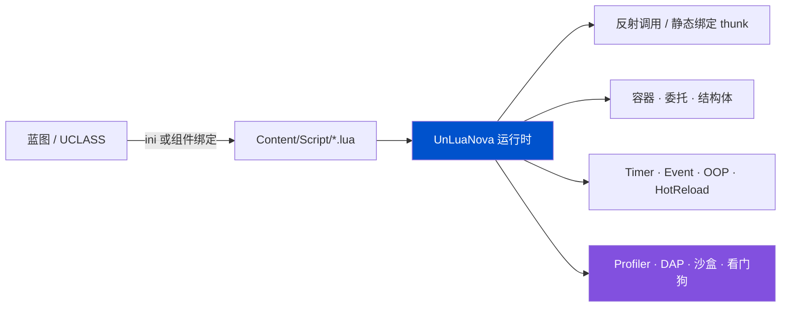

<div align="center">


# UnLuaNova

**Unreal Engine 的 Lua / Luau 脚本方案 —— 不 fork 引擎、能运营期热更、性能可测**

_UnLua 的发布线停在 v2.3.6（2023-11）。这里把散落的社区成果收敛成一条有人维护、可验证、可诊断的发行线。_

[](https://www.unrealengine.com/)
[](Plugins/UnLuaNova/Source/ThirdParty/VERSIONS.md)
[](Docs/CN/Testing.md)
[](LICENSE)
[](https://hustjjd.github.io/UnLuaNova/)
[](README_EN.md)

📖 **在线文档**：<https://hustjjd.github.io/UnLuaNova/>

</div>

---

## 🎬 30 秒看懂

```lua
-- Content/Script/MyActor.lua
local M = UnLuaNova.Class()

function M:ReceiveBeginPlay()
    print("backend:", UnLuaNova.GetBackend())
end

function M:ReceiveTick(DeltaSeconds)
    local Loc = self:K2_GetActorLocation()      -- UFUNCTION，直接调
    Loc.Z = Loc.Z + 100 * DeltaSeconds
    self:K2_SetActorLocation(Loc, false, nil, true)
end

return M
```

绑定不写胶水代码：**类 → Lua 模块的映射写在 ini 里**（或蓝图上加个绑定组件），
UE 侧一行代码都不用改 —— 不再是"必须实现 `IUnLuaNovaInterface`"。



---

## 💎 为什么选 UnLuaNova

九条，每条都写清**机制**，不写形容词。

| # | 优势 | 机制 |
|---|---|---|
| 1 | **覆盖面广，机制透明** | 反射双向调用、覆写、容器与结构体、委托、静态绑定、运行时库、调试与诊断覆盖脚本化开发的主要路径，每项能力都写明机制与边界，见 [功能清单](Docs/CN/Features.md) |
| 2 | **不 fork 引擎，不用改引擎一行代码** | 纯插件，编译进你的工程。对比需要源码引擎分支的方案（UE-AngelScript）和需要替换 il2cpp 运行时的方案（huatuo/HybridCLR）：**升级引擎版本不用等我们适配** |
| 3 | **双后端，Luau 实测更快** | Lua 5.5.1 与 Luau 共用一套后端抽象，编译期切换。同机同构建下，**Luau 在容器负载上比 Lua 5.5.1 快 2.08×**（见下方实测表） |
| 4 | **运营期真热更** | 脚本是数据，可以不重启客户端下发。静态类型的脚本方案做不到 —— 这是 Lua 方案相对 AngelScript / Verse 的**独占优势** |
| 5 | **静态绑定绕开反射热路径** | 构建期为导出类型生成绑定表，运行时不再做反射查找与参数编组。默认**全导出**（opt-out），不想要的加 `meta=(UnLuaNovaNoExport)` |
| 6 | **可观测是内建能力，不是选装** | CPU Profiler 写入 **Unreal Insights**、`lua.dap` 在 VSCode 里断点单步、`lua.dbg` headless 调试服务、`lua.memstats` 按类别看内存分布、死循环看门狗 |
| 7 | **出错时报错，而不是崩** | owned / borrowed 语义分离、悬垂引用检查（`FDanglingCheck`）、Env 归属清晰的回调句柄。访问已失效对象得到可诊断的错误，不是访问违例 |
| 8 | **一条命令验收，性能有门禁** | `Tools/RunTests.ps1` 串起双后端构建、Editor / cooked 用例、真实 DS + 多客户端、类型检查与打包，缺证据即失败。性能有**已提交基线 + 25% 回退门禁** |
| 9 | **MIT 许可** | 没有规模阈值，没有商业授权，没有附加条款。个人、工作室、公司都能免费用，包括商业用途。**不要求签 CLA**，直接提 PR |

---

## 🧪 声明式网络：让 Lua 自己声明 RPC（实验）

UnLua 里 Lua **只能重写引擎已经声明的 RPC**——`ULuaFunction::IsOverridable()` 明确排除带 `FUNC_Net` 的函数。
UnLuaNova 让脚本自己声明 Server / Client / Multicast RPC 与复制字段。这是本项目里少有的、
**上游 UnLua 完全没有**的能力，而不是对既有能力的改良（设计上参考了 slua-unreal）。

```lua
local M = UnLuaNova.Class()

M.ServerRPC    = { RequestDamage = { Reliable = true, Params = { "Int", "String" } } }
M.ClientRPC    = { ShowDamage = true }
M.MulticastRPC = { Explode = true }

function M:GetLifetimeReplicatedProps()
    return {
        { Name = "HP",     Type = "Float" },
        { Name = "Secret", Type = "String", Condition = "OwnerOnly" },
    }
end
```

复制字段支持 8 种条件（`None` / `InitialOnly` / `OwnerOnly` / `SkipOwner` / `SimulatedOnly` /
`AutonomousOnly` / `SimulatedOrPhysics` / `InitialOrOwner`），每种条件有独立存储组：UE 按**属性注册时的条件**
决定发不发，而该注册按类缓存、不能由脚本值决定。`Custom` / `Dynamic`（引擎不支持子对象）、
`Never` / `NetGroup` 与 Replay* 系列等**无存储组的条件**被显式拒绝并打 Error，**不会静默降级成 `None`**。

类型还能写成规格（`Struct:/Script/Engine.Vector`、`Array:<spec>`、`Set:<spec>`、`Map:<key>:<value>`）：
RPC 的 `UFunction` 本来就是运行时构造的，可以直接挂 `FStructProperty` / `FArrayProperty` /
`FSetProperty` / `FMapProperty`；复制字段则走共享 Generic 桶里的自描述文本 payload，规格参与
`SchemaVersion`。**不需要**往 `UClass` 上动态加 `UPROPERTY`（此前把它判成架构边界是错的）。
`UObject` 引用仍走专用 Object 桶，文本 payload 带不了 NetGUID。

> [!WARNING]
> 声明式网络仍是**实验特性**，接口与行为可能调整，不建议在生产环境依赖。引擎级 seamless travel（`ServerTravel`）、热重载与权限检查不在支持范围内。8 种复制条件各有独立存储组，无存储组的条件会被显式拒绝；用法见 [Lua 声明式网络（实验）](Docs/CN/LuaNetworking.md)。

---

## ⚡ 性能：实测数据

同一台机器、同一个构建、两个后端互相跑。原始数据已提交在 [`Tools/baseline/perf-lua.json`](Tools/baseline/perf-lua.json) 与 [`perf-luau.json`](Tools/baseline/perf-luau.json)，
并作为 Release 的回退门禁基线。

| 用例 | 迭代 | Lua 5.5.1 | Luau | Luau 相对 |
|---|---:|---:|---:|---:|
| `VM.Arithmetic` | 200k | 0.0104 µs | **0.0059 µs** | 1.75× |
| `VM.Call` | 200k | 0.0263 µs | **0.0203 µs** | 1.30× |
| `VM.TableRead` | 200k | 0.0092 µs | **0.0076 µs** | 1.20× |
| `VM.TableGrow` | 200k | **0.0120 µs** | 0.0154 µs | 0.78× |
| `Lua.Container.PointsAreCoplanar` | 20k | 22.570 µs | **10.868 µs** | **2.08×** |
| `Reflection`（UE 反射调用） | 20k | 0.5006 µs | **0.4590 µs** | 1.09× |
| `Lua`（脚本侧调用） | 20k | 1.5972 µs | **1.5429 µs** | 1.04× |
| `Native`（C++ 直调，参考下限） | 20k | 0.0019 µs | 0.0017 µs | — |

**测量条件**：Win64 · Editor Development · UE 5.8.3 · MSVC 14.50 · AMD Ryzen 7 4700G · 2026-10-24。
每个用例先预热 ≥ 250 ms，再取 5 段各 ≥ 100 ms 的样本，报**批次均值的中位数**；两个后端迭代数一致。

**边界（请一并读）**：

- 这是**自比基线**，用来挡住性能回退（超过 25% 即 Release 失败）。
- 数据仅覆盖 Lua 5.5.1 与 Luau，**不包含**与 slua-unreal / FUnLua 的同机对照，因此不宣称"比 slua 快"。
- `VM.TableGrow` 上 Lua 5.5.1 更快，我们照实写出来。

---

## ✨ 能力

| | 能力 | 说明 |
|---|---|---|
| ⚡ | **静态绑定** | 构建期生成绑定表，绕开反射热路径；opt-out 默认全导出 |
| 🔁 | **双后端** | [Lua 5.5.1](https://www.lua.org/) 与 [Luau](https://luau.org)（默认），子模块固定提交 |
| 🧩 | **零胶水互操作** | UCLASS / UPROPERTY / UFUNCTION / USTRUCT / UENUM 直接访问；蓝图 Event / Function 可从 Lua 替换；TArray / TMap / TSet 在 Lua 侧是引用语义 |
| 🔍 | **可观测** | Profiler → Unreal Insights、`lua.dap`、`lua.dbg`、`lua.sandbox`、`lua.memstats`、死循环看门狗 |
| 🩺 | **一条命令全验收** | `Tools/RunTests.ps1` 覆盖仓库审计、文档站严格构建、联网矩阵、证据与来源门禁，无需其它命令 |
| ♻️ | **热更新** | 编辑器内 HotReload、PIE 内非结构性热载、运营期脚本下发 |
| 🧪 | **测试随插件发布** | `UnLuaNovaTestSuite` 模块 + 一条命令，报告落在 `Saved/ReleaseTests/` |
| 🧱 | **纯插件** | 不 fork 引擎；后端是编译期选择，运行时不共存 |
| 🌐 | **声明式网络（实验）** | Lua 自己声明 RPC 与复制字段；8 种条件各有独立存储组，参数/字段支持 `UStruct` 与容器类型规格，边界见 [网络文档](Docs/CN/LuaNetworking.md) |

---

## 🆚 怎么选

| 方案 | 强项 | 什么时候不选它 |
|---|---|---|
| **Tencent/UnLua** | 反射与覆写成熟、用得多 | 发布线停在 v2.3.6（2023-11），`develop` 只有零星修复，没版本号也没维护者 |
| **slua-unreal** | 产品能力全：CppBinding、Profiler、真机调试 | BSD-3-Clause，API 与本方案不同，迁移需独立适配 |
| **FUnLua** | 对象引用树、属性失效、实例绑定设计扎实 | 许可文件在固定提交中缺失（核实前不引用其源码） |
| **UE-AngelScript** | 静态类型、VSCode LSP、断点单步 | **需要源码引擎分支**，无运营期热更 |
| **Verse / 蓝图** | 官方、零集成 | 不能运营期热更，迭代受限于发版 |
| **UnLuaNova** | 不 fork 引擎 + 双后端 + 热更 + 可观测 + 可验收 + MIT + 声明式网络（实验） | 声明式网络仍为实验特性，接口与行为可能调整；已验证平台为 UE 5.8.3 / Win64 |

**一句话边界**：能接受**源码引擎分支**、只做主机/PC 单机、不需要运营期热更 → UE-AngelScript 体验更完整。
**不能 fork 引擎 / 要热更 / 团队会 Lua** → UnLuaNova 是现实解。

---

## 🚀 快速开始

<details open>
<summary><b>① 放进工程</b></summary>

1. 把 `Plugins/` 里需要的插件拷到你项目的 `Plugins/` 下
2. 初始化子模块：`git submodule update --init --recursive`
3. 在 `.uproject` 里启用 **UnLuaNova**，重新生成工程文件并编译

</details>

<details>
<summary><b>② 选后端并绑定</b></summary>

普通工程里后端是**编译期**选择，`Config/DefaultUnLuaNova.ini`：

```ini
[/Script/UnLuaNovaEditor.UnLuaNovaEditorSettings]
LuaBackend=Luau        ; 或 Lua；改完要重新编译
```

**示例工程可以不这么折腾**：`UnLuaNovaDemo<Lua|Luau>{Editor,Server,''}` 六个 target 各有一套
独立产物，各编一次之后切后端**零编译**。后端隔离是默认且唯一的方式，不需要任何开关：
Editor / Game / Server 载体、`-NetMatrix` 和完整 Release 矩阵一律使用隔离 target。
不只 DLL：cook 输出落在 `Saved/Cooked/Backends/<后端>/...`，静态绑定生成源码落在
`Source/UnLuaNova/Generated/Backends/<后端>/`，都按后端（cook 还按配置）分开，互不覆盖：

```powershell
# Editor 快速路径（Game / Server target 见文档）
Build.bat UnLuaNovaDemoLuaEditor  Win64 Development -Project=UnLuaNovaDemo.uproject -WaitMutex
Build.bat UnLuaNovaDemoLuauEditor Win64 Development -Project=UnLuaNovaDemo.uproject -WaitMutex
.\Tools\SwitchBackend.ps1 -Backend Lua     # 或 Luau；-Status 看当前，-Backend Default 回到普通布局
.\Tools\RunDevelopmentTests.ps1 -Backend Both
.\Tools\RunTests.ps1                    # 完整 Release，无参数
```

原理、六个 target 的构建命令与边界见
[测试与自动化 / 后端隔离构建](Docs/CN/Testing.md#后端隔离构建)。

用 UnLuaNova 工具栏把蓝图绑到模块，脚本放 `Content/Script/`。
从 UnLua 迁移只需把全局名 `UnLua` 批量换成 `UnLuaNova`。

</details>

<details>
<summary><b>③ 跑验收</b></summary>

```powershell
.\Tools\RunTests.ps1
```

**这是唯一需要运行的命令。** 它不接受参数，内部依次执行：仓库审计、Python / PowerShell
工具回归、两个分析器构建、`mkdocs build --strict` 文档站、双后端 Editor / cooked /
Server / Shipping 构建与自动化、8 场景 + 4 变体联网矩阵（双后端各 12 个 cell）、
执行证据采集、来源与转正门禁，最后自动刷新 8 处 `release-status` / `release-provenance` 标记。
结果写入 `Saved/ReleaseTests/test/release-summary.{json,md}`，任一阶段失败即整轮失败。

`Tools/RunDevelopmentTests.ps1` 只用于局部调试（`-Filter` / `-BuildOnly` 等），不产生发布
结论，也不需要为了验收单独运行。UE 6.0 冷 cook 可先设
`$env:UNLUANOVA_RELEASE_TIMEOUT_MINUTES = 180`（唯一可调旋钮，不改变验收范围）。

</details>

---

## 🧪 验证状态

<!-- release-status: not-passed -->
<!-- release-provenance: 0b5b29b2 -->

当前代码树**尚未**通过一次完整的验收。最近一次 Release（`Saved/ReleaseTests/test/release-summary.json`）为 `passed=false`：`Luau-package-development` 在 UE 6.0 冷 cook 阶段超过 60 分钟超时。新引擎首次打包会全量编译 shader，属于预期成本，但需要单独调整超时。

上面的 `release-status` / `release-provenance` 注释由 `Tools/UpdateReleaseStatus.py` 在每次 Release 写出摘要后自动生成，标注的是**产生该状态的那次运行**的提交；较旧的历史运行保留在对比基线中。「当前树是否有执行证据」由 `ReleasePipeline.ps1` 的 `release-provenance` 阶段（`ValidateProvenance.py --require-current`）判定。用例总数以 `release-summary.json` 为准，不再手工写进徽章。

本地复现执行 `.\Tools\RunTests.ps1`（见 [测试与自动化](Docs/CN/Testing.md)）；UE 6.0 冷 cook 可先设 `$env:UNLUANOVA_RELEASE_TIMEOUT_MINUTES = 180`。已验证组合见 [引擎版本与平台支持矩阵](Docs/CN/Engine_Support.md)。

---

## ⚠️ 当前边界

以下是面向使用者的已知限制：

| 领域 | 边界 |
|---|---|
| **声明式网络（实验）** | 支持 8 种复制条件（每种独立存储组），`Custom` / `Dynamic` / `Never` / `NetGroup` 与 Replay 系列等无存储组的条件会被显式拒绝；`UStruct` / 容器通过类型规格支持。引擎级 seamless travel（`ServerTravel`）、热重载与权限检查不在支持范围内 |
| **生成 thunk** | 最终派发仍经由 `UObject::ProcessEvent`；静态绑定省去的是反射查找与参数编组 |
| **Luau 原生编译** | 需显式开启 `lua.codegen.enabled=1`（默认 0），可用 `lua.codegen.modules` 限定模块；仅对切换后加载的 chunk 生效，且仅支持 Luau + x64/arm64 |
| **平台与引擎版本** | 已验证基线为 UE **5.8.3 / Win64**；UE 6.0 已有适配分支但尚无通过的完整 Release。详见 [支持矩阵](Docs/CN/Engine_Support.md)——声明的其余平台是编译目标，不是已验收配置 |
| **同类实例绑定** | `BindInstance` / `UnbindInstance` 已提供；默认仍按 `UClass` 缓存，须先完成类级绑定，覆写为类级函数名并集，实例路径逐次解析 Lua 函数。见 [实例级模块绑定](Docs/CN/InstanceBinding.md) |
| **沙盒** | `lua.sandbox` 默认关闭；路径检查不是 OS 级沙盒，不可信脚本需另定能力策略 |

功能与用法见 [功能清单](Docs/CN/Features.md)、[编程指南](Docs/CN/UnLuaNova_Programming_Guide.md) 与 [版本说明](Docs/CN/ReleaseNotes.md)。

---

## 📚 文档

| 分类 | 入口 |
|---|---|
| 入门 | [快速开始](Docs/CN/Quickstart_For_UE_Newbie.md) · [功能清单](Docs/CN/Features.md) · [编程指南](Docs/CN/UnLuaNova_Programming_Guide.md) · [示例](Docs/CN/Showcase.md) |
| 深入 | [架构](Docs/CN/Architecture.md) · [API](Docs/CN/API.md) · [C++ API](Docs/CN/CxxApi.md) · [静态导出绑定](Docs/CN/StaticExportBinding.md) · [设置](Docs/CN/Settings.md) |
| 后端 | [Luau 能力与兼容边界](Docs/CN/Luau.md) · [内置库](Docs/CN/StdLib.md) |
| 工具 | [调试](Docs/CN/Debugging.md) · [控制台命令](Docs/CN/ConsoleCommand.md) · [智能提示](Docs/CN/IntelliSense.md) · [测试](Docs/CN/Testing.md) |
| 现状 | [引擎版本与平台支持矩阵](Docs/CN/Engine_Support.md) · [版本说明](Docs/CN/ReleaseNotes.md) · [FAQ](Docs/CN/FAQ.md) |

**验证环境**（上一次通过的基线）：Windows 11 · Unreal Engine **5.8.3**（源码构建）· Win64 · Visual Studio 2026 18.10（MSVC 14.50）· Lua 5.5.1 / Luau 0.743+1。完整范围见 [支持矩阵](Docs/CN/Engine_Support.md)。

---

## 📄 许可

**[MIT](LICENSE)** —— 没有规模阈值，没有商业授权，没有附加条款。个人、爱好者、工作室与公司都可以免费使用，包括商业用途，不需要买任何东西。也不要求签 CLA，直接提 PR 就行。

继承与第三方组件（Tencent/UnLua、Lua、Luau、LuaSocket、lua-protobuf、lua-rapidjson 等）仍按它们自己的许可，由各自版权人授予，见 [LICENSE-THIRD-PARTY.md](LICENSE-THIRD-PARTY.md)。Unreal Engine 本身受 Epic 的独立条款约束，本许可不授予引擎代码或资产的任何权利。

详情见 [许可与来源](Docs/CN/License.md)；贡献方式见 [CONTRIBUTING.md](CONTRIBUTING.md)。

---

## 🙏 致谢与合规

- 本项目 fork 自 [Tencent/UnLua](https://github.com/Tencent/UnLua)（MIT），继承其反射、覆写、容器与委托集成。
- [slua-unreal](https://github.com/Tencent/sluaunreal)（BSD-3-Clause）与 [FUnLua](https://github.com/fcscript/FUnLua) 是**设计对照来源**：仅借鉴设计并记录来源，未复制其实现；不代表其作者为本项目背书，也不自动授权复制其实现。
- [Luau](https://luau.org)（MIT）由 Roblox 开源，作为可选后端以固定提交引入。
- `Unreal®` 是 Epic Games, Inc. 的商标。本项目为社区独立项目，**非 Epic 官方产品，未获 Epic 认可**。

<br/>

<div align="center">
觉得有用的话，点个 ⭐ 让更多人看到它。
</div>
