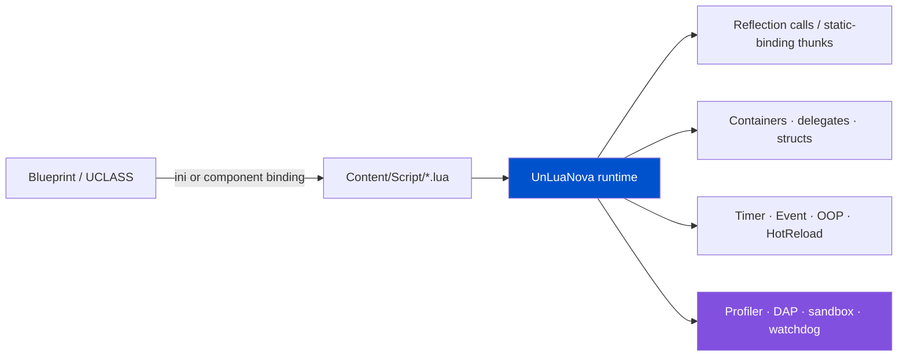

<div align="center">


# UnLuaNova

**Lua / Luau scripting for Unreal Engine — no engine fork, runtime hot updates, measurable performance**

_UnLua's release line stopped at v2.3.6 (2023-11). This is where the scattered community work becomes one maintained, verifiable, diagnosable distribution._

[](https://www.unrealengine.com/)
[](Plugins/UnLuaNova/Source/ThirdParty/VERSIONS.md)
[](Docs/EN/Testing.md)
[](LICENSE)
[](https://hustjjd.github.io/UnLuaNova/)
[](README.md)

📖 **Documentation**: <https://hustjjd.github.io/UnLuaNova/>

</div>

---

## 🎬 In 30 seconds

```lua
-- Content/Script/MyActor.lua
local M = UnLuaNova.Class()

function M:ReceiveBeginPlay()
    print("backend:", UnLuaNova.GetBackend())
end

function M:ReceiveTick(DeltaSeconds)
    local Loc = self:K2_GetActorLocation()      -- any UFUNCTION, called directly
    Loc.Z = Loc.Z + 100 * DeltaSeconds
    self:K2_SetActorLocation(Loc, false, nil, true)
end

return M
```

Binding needs no glue code: the **class → Lua module mapping lives in an ini file** (or in a binding
component on the Blueprint), so the UE side does not change by a single line — implementing
`IUnLuaNovaInterface` is no longer a requirement.



---

## 💎 Why UnLuaNova

Nine reasons, each with the **mechanism** behind it — no adjectives.

| # | Advantage | Mechanism |
|---|---|---|
| 1 | **Broad coverage, transparent mechanisms** | Reflection calls, overrides, containers and structs, delegates, static binding, runtime libraries, debugging and diagnostics cover the main paths of script-driven development. Each capability documents its mechanism and boundary — see [Features](Docs/EN/Features.md) |
| 2 | **No engine fork, no engine changes** | A pure plugin compiled into your project. Compare with solutions that need a source engine branch (UE-AngelScript) or replace the il2cpp runtime (huatuo/HybridCLR): **upgrading your engine version does not wait on us** |
| 3 | **Two backends, and Luau measures faster** | Lua 5.5.1 and Luau share one backend abstraction, switched at compile time. On the same machine and build, **Luau is 2.08× faster than Lua 5.5.1** on a container workload (table below) |
| 4 | **Real runtime hot updates** | Scripts are data and can be shipped without restarting the client. Statically typed scripting solutions cannot do this — it is the **exclusive advantage** of a Lua solution over AngelScript / Verse |
| 5 | **Static binding bypasses the reflection hot path** | Binding tables are generated at build time, so no reflection lookup or parameter marshalling happens at runtime. Everything is exported by default (opt-out) via `meta=(UnLuaNovaNoExport)` |
| 6 | **Observability built in, not bolted on** | CPU profiler into **Unreal Insights**, `lua.dap` breakpoints and stepping in VSCode, `lua.dbg` headless debug service, `lua.memstats` memory by category, infinite-loop watchdog |
| 7 | **It errors, it does not crash** | Owned / borrowed semantics are separated, dangling references are checked (`FDanglingCheck`), callback handles carry their Env. Touching a dead object gives a diagnosable error, not an access violation |
| 8 | **One-command acceptance, performance gated** | `Tools/RunTests.ps1` runs both backend builds, Editor + cooked automation, real dedicated-server networking, type checks and packaging, failing on missing evidence. Performance has a **committed baseline and a 25% regression gate** |
| 9 | **MIT licensed** | No size threshold, no commercial license, no additional terms. Free for individuals, studios and companies alike, including commercially. **No CLA** — just open a PR |

---

## 🧪 Declarative networking: RPCs declared by Lua (experimental)

In UnLua, Lua can **only re-implement RPCs the engine already declared** -
`ULuaFunction::IsOverridable()` explicitly excludes functions carrying `FUNC_Net`.
UnLuaNova lets a script declare its own Server / Client / Multicast RPCs and replicated fields.
This is one of the few capabilities in this project that **upstream UnLua does not have at all**
(its design references slua-unreal), rather than an improvement to something that already
existed.

```lua
local M = UnLuaNova.Class()

M.ServerRPC    = { RequestDamage = { Reliable = true, Params = { "Int", "String" } } }
M.ClientRPC    = { ShowDamage = true }
M.MulticastRPC = { Explode = true }

function M:GetLifetimeReplicatedProps()
    return {
        { Name = "HP",     Type = "Float" },
        { Name = "Secret", Type = "String", Condition = "OwnerOnly" },
    }
end
```

Replicated fields support eight conditions (`None` / `InitialOnly` / `OwnerOnly` / `SkipOwner` /
`SimulatedOnly` / `AutonomousOnly` / `SimulatedOrPhysics` / `InitialOrOwner`), each with its own
storage group: UE decides whether to send a property from **the condition it was registered with**,
and that registration is cached per class and cannot depend on a script value.
`Custom` / `Dynamic` (the engine refuses custom conditions on subobjects), `Never` / `NetGroup`
and the Replay* family - every condition with no storage group - are rejected with an Error and
**never silently downgraded to `None`**.

Types can also be **specs** (`Struct:/Script/Engine.Vector`, `Array:<spec>`, `Set:<spec>`,
`Map:<key>:<value>`): the RPC `UFunction` is built at runtime, so it can own an
`FStructProperty` / `FArrayProperty` / `FSetProperty` / `FMapProperty` directly, while replicated
fields use a canonical self-describing payload in a shared Generic bucket with the spec folded
into `SchemaVersion`. **No `UPROPERTY` is added to a `UClass` at runtime** - the earlier claim
that this was an architectural boundary was wrong. `UObject` references keep the dedicated
Object bucket because a text payload cannot carry a NetGUID.

> [!WARNING]
> Declarative networking is still **experimental**: its API and behaviour may change, and production use is not recommended. Engine-level seamless travel (`ServerTravel`), hot reload and authorization checks are out of scope. Eight replication conditions each have their own storage group, and conditions with no storage group are rejected explicitly. See [Lua-declared networking (experimental)](Docs/EN/LuaNetworking.md).

---

## ⚡ Performance: measured

Both backends, same machine, same build. Raw data is committed in
[`Tools/baseline/perf-lua.json`](Tools/baseline/perf-lua.json) and
[`perf-luau.json`](Tools/baseline/perf-luau.json) and gates Release.

| Case | Iterations | Lua 5.5.1 | Luau | Luau relative |
|---|---:|---:|---:|---:|
| `VM.Arithmetic` | 200k | 0.0104 µs | **0.0059 µs** | 1.75× |
| `VM.Call` | 200k | 0.0263 µs | **0.0203 µs** | 1.30× |
| `VM.TableRead` | 200k | 0.0092 µs | **0.0076 µs** | 1.20× |
| `VM.TableGrow` | 200k | **0.0120 µs** | 0.0154 µs | 0.78× |
| `Lua.Container.PointsAreCoplanar` | 20k | 22.570 µs | **10.868 µs** | **2.08×** |
| `Reflection` (UE reflection call) | 20k | 0.5006 µs | **0.4590 µs** | 1.09× |
| `Lua` (script-side call) | 20k | 1.5972 µs | **1.5429 µs** | 1.04× |
| `Native` (direct C++ call, floor reference) | 20k | 0.0019 µs | 0.0017 µs | — |

**Conditions**: Win64 · Editor Development · UE 5.8.3 · MSVC 14.50 · AMD Ryzen 7 4700G · 2026-10-24.
Each case warms up for ≥ 250 ms, then takes 5 samples of ≥ 100 ms each and reports the **median of batch
means**; both backends use identical iteration counts.

**Limits (read them too)**:

- This is a **self-baseline**: it guards against regressions (over 25% fails Release).
- The data covers Lua 5.5.1 and Luau only. It is **not** a same-machine comparison against
  slua-unreal / FUnLua, so no "faster than slua" claim is made.
- Lua 5.5.1 is faster on `VM.TableGrow`, and we say so.

---

## ✨ What it does

| | Capability | Notes |
|---|---|---|
| ⚡ | **Static binding** | Build-time binding tables; opt-out, everything exported by default |
| 🔁 | **Two backends** | [Lua 5.5.1](https://www.lua.org/) and [Luau](https://luau.org) (default), pinned as submodules |
| 🧩 | **Glue-free interop** | UCLASS / UPROPERTY / UFUNCTION / USTRUCT / UENUM directly; Blueprint Events and Functions replaceable from Lua; TArray / TMap / TSet are reference semantics |
| 🔍 | **Observable** | Profiler → Unreal Insights, `lua.dap`, `lua.dbg`, `lua.sandbox`, `lua.memstats`, watchdog |
| 🩺 | **One-command acceptance** | `Tools/RunTests.ps1`; `Tools/AuditRepository.py` checks the repo without compiling |
| ♻️ | **Hot reload** | In-editor reload, non-structural reload in PIE, runtime script shipping |
| 🧪 | **Tests ship with the plugin** | The `UnLuaNovaTestSuite` module plus one command; reports land in `Saved/ReleaseTests/` |
| 🧱 | **Pure plugin** | No engine fork; the backend is a compile-time choice |
| 🌐 | **Declarative networking (experimental)** | Lua declares its own RPCs and replicated fields; eight conditions each have a storage group, and parameters/fields accept `UStruct` and container type specs, limits in the [networking doc](Docs/EN/LuaNetworking.md) |

---

## 🆚 How to choose

| Project | Strengths | When not to pick it |
|---|---|---|
| **Tencent/UnLua** | Mature reflection and overrides, widely deployed | Release line stopped at v2.3.6 (2023-11); `develop` carries scattered fixes, no version and no maintainer |
| **slua-unreal** | Full product surface: CppBinding, profiler, on-device debugging | BSD-3-Clause; different API, migration needs its own mapping |
| **FUnLua** | Solid object-reference tree, property invalidation, per-instance binding design | Its license file is missing at the pinned commit, so its source is not referenced until verified |
| **UE-AngelScript** | Static types, VSCode LSP, breakpoints as a first-class citizen | **Requires a source engine fork**; no runtime hot updates |
| **Verse / Blueprint** | Official, zero integration | No runtime hot updates; iteration is bound to releases |
| **UnLuaNova** | No engine fork + two backends + hot updates + observability + acceptance + MIT + declarative networking (experimental) | Declarative networking is experimental and its API may change; validated on UE 5.8.3 / Win64 |

**One-line boundary**: if you can accept a **source engine fork**, target PC/console single-player and do
not need runtime updates, UE-AngelScript is the more complete experience. If you **cannot fork the
engine, need hot updates, or your team knows Lua**, UnLuaNova is the practical answer.

---

## 🚀 Quick start

<details open>
<summary><b>① Drop it in</b></summary>

1. Copy the plugins you need from `Plugins/` into your project's `Plugins/`
2. Initialize submodules: `git submodule update --init --recursive`
3. Enable **UnLuaNova** in your `.uproject`, regenerate project files, build

</details>

<details>
<summary><b>② Pick a backend and bind</b></summary>

In a normal project the backend is a **compile-time** choice, in `Config/DefaultUnLuaNova.ini`:

```ini
[/Script/UnLuaNovaEditor.UnLuaNovaEditorSettings]
LuaBackend=Luau        ; or Lua; rebuild after changing
```

The example project has a faster path: `UnLuaNovaDemo<Lua|Luau>{Editor,Server,''}` build into
separate trees, so after one build each, switching backends costs **no compile**.
`-BackendTargets` works for Editor / Game / Server carriers, `-NetMatrix` and the full
Release matrix:

```powershell
# Editor fast path (Game / Server target commands are in the docs)
Build.bat UnLuaNovaDemoLuaEditor  Win64 Development -Project=UnLuaNovaDemo.uproject -WaitMutex
Build.bat UnLuaNovaDemoLuauEditor Win64 Development -Project=UnLuaNovaDemo.uproject -WaitMutex
.\Tools\SwitchBackend.ps1 -Backend Lua     # or Luau; -Status, -Backend Default
.\Tools\RunTests.ps1 -Profile Development -BackendTargets -Backend Both
.\Tools\RunTests.ps1 -Profile Release -BackendTargets
```

See [Testing / Backend-isolated builds](Docs/EN/Testing.md#backend-isolated-builds--backendtargets).

Bind a Blueprint to a module from the UnLuaNova toolbar and put scripts in `Content/Script/`.
Migrating from UnLua is a rename: `UnLua` → `UnLuaNova`.

</details>

<details>
<summary><b>③ Run the acceptance suite</b></summary>

```powershell
.\Tools\RunTests.ps1                 # full release: both backends, networking, type checks, packaging, perf gate
.\Tools\RunTests.ps1 -Profile Development -Filter UnLuaNova.API
python Tools/AuditRepository.py      # repository consistency, no compile
```

</details>

---

## 🧪 Verification status

<!-- release-status: passed -->
<!-- release-provenance: 347bb8c5 -->

The current release has passed the full build, automation and packaging acceptance run. Reproduce it locally with `.\Tools\RunTests.ps1`; commands and artifacts are described in [Testing and Automation](Docs/EN/Testing.md).

---

## ⚠️ Current limits

Known limitations for users:

| Area | Limit |
|---|---|
| **Declarative networking (experimental)** | Eight replication conditions, each with its own storage group; `Custom` / `Dynamic` / `Never` / `NetGroup` and the Replay* family are rejected explicitly. `UStruct` and container type specs are supported. Engine-level seamless travel (`ServerTravel`), hot reload and authorization checks are out of scope |
| **Generated thunks** | Final dispatch still goes through `UObject::ProcessEvent`; static binding removes the runtime reflection lookup and marshalling |
| **Luau native codegen** | Opt-in via `lua.codegen.enabled=1` (default 0), narrow it with `lua.codegen.modules`. Applies only to chunks loaded after the switch, and only on Luau + x64/arm64 |
| **Engine versions and platforms** | Verified on UE **5.8.3 / Win64**. Other engine versions, Linux / Mac / iOS / Android and consoles need their own acceptance |
| **Per-instance binding** | `BindInstance` / `UnbindInstance` are available; class-level binding remains the default cache and must be established first. Overrides form a class-level union of function names and instance-bound objects resolve Lua functions per call. See `Docs/CN/InstanceBinding.md` |
| **Sandbox** | `lua.sandbox` is off by default; path checks are not an OS-level sandbox. Untrusted scripts need their own capability policy |

See [Features](Docs/EN/Features.md), the [Programming guide](Docs/EN/UnLuaNova_Programming_Guide.md) and [Release notes](Docs/EN/ReleaseNotes.md).

---

## 📚 Documentation

| Category | Entry points |
|---|---|
| Start here | [Quickstart](Docs/EN/Quickstart_For_UE_Newbie.md) · [Programming guide](Docs/EN/UnLuaNova_Programming_Guide.md) · [API](Docs/EN/API.md) · [Examples](Docs/EN/Showcase.md) |
| Deeper | [Architecture](Docs/EN/Architecture.md) · [C++ API](Docs/EN/CxxApi.md) · [Settings](Docs/EN/Settings.md) |
| Backends | [Luau capabilities and compatibility](Docs/EN/Luau.md) · [Standard library](Docs/EN/StdLib.md) |
| Tooling | [Debugging](Docs/EN/Debugging.md) · [Console commands](Docs/EN/ConsoleCommand.md) · [Testing](Docs/EN/Testing.md) |
| Status | [Release notes](Docs/EN/ReleaseNotes.md) · [FAQ](Docs/EN/FAQ.md) |

**Verified environment**: Windows 11 · Unreal Engine **5.8.3** (source build) · Win64 · Visual Studio 2026 18.10 (MSVC 14.50) · Lua 5.5.1 / Luau 0.743+1

---

## 📄 License

**[MIT](LICENSE)** — no size threshold, no commercial license, no additional terms. Free for individuals, hobbyists, studios and companies alike, including commercial use; there is nothing to buy. No CLA is required either — just open a PR.

Inherited and third-party components (Tencent/UnLua, Lua, Luau, LuaSocket, lua-protobuf, lua-rapidjson, …) stay under their own licenses, granted by their own copyright holders ([LICENSE-THIRD-PARTY.md](LICENSE-THIRD-PARTY.md)). Unreal Engine itself is governed by Epic's separate terms; this license grants no rights to engine code or assets.

See [license and provenance](Docs/EN/License.md), and [CONTRIBUTING.md](CONTRIBUTING.md) for how to contribute.

---

## 🙏 Credits and compliance

- Forked from [Tencent/UnLua](https://github.com/Tencent/UnLua) (MIT); inherits its reflection, override, container and delegate integration.
- [slua-unreal](https://github.com/Tencent/sluaunreal) (BSD-3-Clause) and [FUnLua](https://github.com/fcscript/FUnLua) are **design references only**: design ideas are recorded with attribution and no implementation was copied. Neither project's authors endorse this one, and neither grants permission to copy their source.
- [Luau](https://luau.org) (MIT), open-sourced by Roblox, is pinned as an optional backend.
- `Unreal®` is a trademark of Epic Games, Inc. This is an independent community project — **not an Epic product and not endorsed by Epic**.

<br/>

<div align="center">
If this is useful to you, leave a ⭐ so more people find it.
</div>
